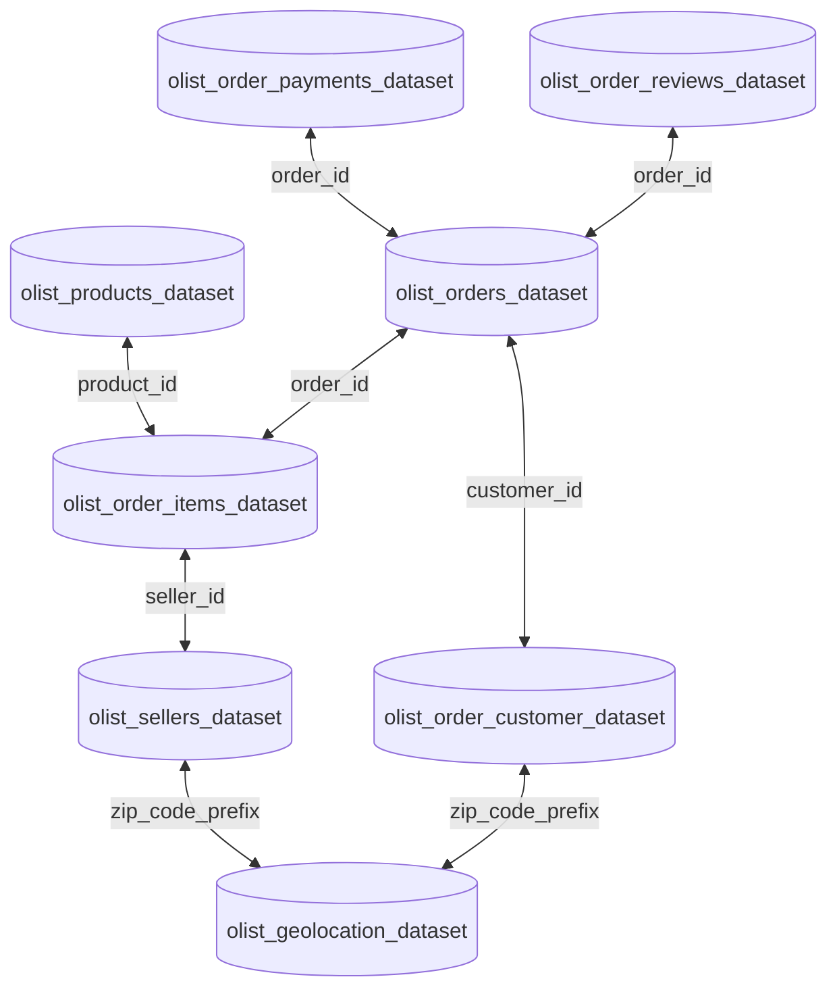

## UNIVERSIDADE DE SÃO PAULO
### ESCOLA DE ARTES, CIÊNCIAS E HUMANIDADES
#### BACHARELADO EM MARKETING

**DANILO LINDEMBERG AMORIM**

**Análise de Componentes Principais: Uma visão expandida do método clássico**

São Paulo
2020

## **DANILO LINDEMBERG AMORIM**

### **Análise de Componentes Principais: Uma visão expandida do método clássico**

#### Versão original

Monografia apresentada à Escola de Artes, Ciências e Humanidades da Universidade de São Paulo para obtenção do título de Bacharel em Marketing.

**Orientador:**

Profa. Dra. Sumaia Abdel Latif

São Paulo
2020

*Dedicado integralmente à minha esposa Aline - acolhedora dos meus anseios, ouvinte paciente e sábia conselheira...*

## **RESUMO**

**AMORIM, Danilo. **Análise de componentes principais**: Uma visão expandida do método clássico. 2020. Monografia (Bacharelado em Marketing) – Escola de Artes, Ciências e Humanidades, Universidade de São Paulo, São Paulo, 2020. Versão original.**

Neste trabalho investiga-se a Análise de Componentes Principais (ACP) como técnica estatística multivariada utilizada com o objetivo de redução de dimensão ou de apenas entendimento da estrutura subjacente aos dados. Realiza-se uma revisão bibliográfica ampla da técnica clássica e acrescenta-se desenvolvimentos que dela surgiram tais como Análise de Componentes Principais Não-Linear (ACPNL) e a Análise de Componentes Principais Logística (ACP Logística) para as distribuições da família exponencial. Em seguida, aplica-se a ACPNL a um conjunto de dados por meio do R *package* e desenvolve-se uma análise dos resultados proporcionados pela técnica. Conclui-se o estudo com uma descrição das contribuições que a análise clássica e seus desenvolvimentos posteriores forneceram ao conhecimento científico, seus usos e aplicações na área de Marketing, e, por fim, recomendações de ampliação do trabalho desenvolvido.

**Palavras-chave:** Análise de componentes principais, Redução de dados, Análise de componentes principais não-linear.

## **ABSTRACT**

**AMORIM, Danilo.** **Principal Component Analysis:** An expanded view of the classical method. 2020. Monography (Bsc in Marketing) – School of Arts, Sciences and Humanities, University of São Paulo, São Paulo, 2020. Original version.

In this work, it is investigated the Principal Component Analysis (PCA) as a multivariate statistics analysis technique used as aiming on the dimensionality reduction or solely understanding the subjacent data structure. It is performed a broad literature review of the classical technique and added up developments risen from it such a Non-Linear Principal Components Analysis (NLPCA) and Logistic Principal Components Analysis (Logistic PCA) for distributions of the exponential family. Next on, NLPCA is applied to a dataset by means of the R package and it is developed an analysis of the results achieved with the technique. The study is concluded with a description of the contributions that the classical analysis and its posterior developments provided to the scientical knowledge, its uses and applications in the Marketing field, and, finally, recommendations to broadening the presented work.

**Keywords:** Principal component analysis, Dimensionality reduction, Non-linear principal component analysis.

## **LISTA DE FIGURAS**

<table><tr><td>Figura 1 - Exemplo de Scree Plot</td><td>18</td></tr>
<tr><td>Figura 2 - Exemplo de Diagrama LEV</td><td>19</td></tr>
<tr><td>Figura 3 - Exemplo de gráfico de pontos de uma variável com evidência de outlier</td><td>22</td></tr>
<tr><td>Figura 4 - Gráficos de dispersão para pares de variáveis com evidência de outlier</td><td>22</td></tr>
<tr><td>Figura 5 - Gráfico de dispersão de duas componentes principais</td><td>23</td></tr>
<tr><td>Figura 6 - Boxplot paralelos das componentes principais</td><td>24</td></tr>
<tr><td>Figura 7 - Exemplo de QQ-plot para uma distribuição gama</td><td>25</td></tr>
<tr><td>Figura 8 – Exemplos de gráficos de transformação para diferentes quantificações de uma mesma variável</td><td>36</td></tr>
<tr><td>Figura 9 - Exemplo de representação de uma variável categórica fictícia de idade como vetor ........................................................................................................................</td><td>39</td></tr>
<tr><td>Figura 10 - <em>Marketplaces</em> integrados com a plataforma Olist</td><td>46</td></tr>
<tr><td>Figura 11 - Organização relacional do conjunto de dados Olist</td><td>47</td></tr>
<tr><td>Figura 12 - Gráficos de frequência das variáveis nominais e ordinais</td><td>50</td></tr>
<tr><td>Figura 13 - Histogramas e <em>boxplots</em> das variáveis métricas</td><td>51</td></tr>
<tr><td>Figura 14 - <em>Scree plot</em> para quantificações nominais</td><td>54</td></tr>
<tr><td>Figura 15 - Gráfico de cargas nas componentes 1 e 2 para quantificações nominais</td><td>55</td></tr>
<tr><td>Figura 16 - Gráfico de transformação para quantificações nominais</td><td>57</td></tr>
<tr><td>Figura 17 – <em>Scree plot</em> para quantificações ordinais em cinco variáveis</td><td>58</td></tr>
<tr><td>Figura 18 – Gráfico de cargas para as componentes 1 e 2 com quantificações ordinais em cinco variáveis</td><td>59</td></tr>
<tr><td>Figura 19 – Gráfico de transformação para quantificações ordinais em cinco variáveis</td><td>60</td></tr>
<tr><td>Figura 20 – <em>Scree plot</em> para quantificações nominais e quatro componentes</td><td>61</td></tr>
<tr><td>Figura 21 – Gráfico de cargas para quantificações nominais e quatro componentes</td><td>62</td></tr>
<tr><td>Figura 22 – Gráfico de transformação para quantificações nominais e quatro componentes ..62</td><td></td></tr>
<tr><td>Figura 23 – <em>Scree plot</em> para quantificações nominais em cinco componentes via <em>splines</em></td><td>64</td></tr>
<tr><td>Figura 24 – Gráfico de cargas para quantificações nominais e cinco componentes via <em>splines</em> ........................................................................................................................</td><td>65</td></tr>
<tr><td>Figura 25 – Gráfico de transformação para quantificações nominais e cinco componentes via <em>splines</em></td><td>65</td></tr></table>

## **LISTA DE QUADROS**

<table><tr><td>Quadro 1 - Requisitos e considerações por nível de análise</td><td>34</td></tr>
<tr><td>Quadro 2 - Variáveis selecionadas para análise</td><td>49</td></tr></table>

## **SUMÁRIO**

<table><tr><td><strong>1. INTRODUÇÃO</strong></td><td><strong>11</strong></td></tr>
<tr><td>1.1. INTRODUÇÃO</td><td>11</td></tr>
<tr><td>1.2. OBJETIVOS</td><td>11</td></tr>
<tr><td>1.3. JUSTIFICAVA</td><td>11</td></tr>
<tr><td>1.4. METODOLOGIA</td><td>12</td></tr>
<tr><td><strong>2. ANÁLISE DE COMPONENTES PRINCIPAIS CLÁSSICA</strong></td><td><strong>14</strong></td></tr>
<tr><td>2.1. INTRODUÇÃO</td><td>14</td></tr>
<tr><td>2.2. FUNDAMENTOS DA ANÁLISE DE COMPONENTES PRINCIPAIS CLÁSSICA</td><td>15</td></tr>
<tr><td>2.2.1. Obtenção das componentes através da matriz de covariância</td><td>15</td></tr>
<tr><td>2.2.2. Extração das componentes principais</td><td>16</td></tr>
<tr><td>2.2.2.1. <em>Métodos tradicionais</em></td><td>16</td></tr>
<tr><td>2.2.2.2. <em>Métodos de validação cruzada</em></td><td>19</td></tr>
<tr><td>2.2.3. Detecção de <em>outliers</em></td><td>21</td></tr>
<tr><td>2.2.4. Observações influentes</td><td>26</td></tr>
<tr><td>2.2.5. Estimação robusta</td><td>30</td></tr>
<tr><td>2.2.6. Rotação das componentes principais</td><td>31</td></tr>
<tr><td><strong>3. ANÁLISE DE COMPONENTES PRINCIPAIS NÃO-LINEAR</strong></td><td><strong>33</strong></td></tr>
<tr><td>3.1. CONCEITOS FUNDAMENTAIS</td><td>33</td></tr>
<tr><td>3.2. VISUALIZAÇÃO DAS TRANSFORMAÇÕES</td><td>35</td></tr>
<tr><td>3.3. ESTIMAÇÃO, RETENÇÃO E ROTAÇÃO DAS COMPONENTES PRINCIPAIS</td><td>37</td></tr>
<tr><td>3.4. REPRESENTAÇÕES GRÁFICAS NO ESPAÇO DAS COMPONENTES PRINCIPAIS</td><td>38</td></tr>
<tr><td>3.4.1. Representação das variáveis originais através de vetores</td><td>38</td></tr>
<tr><td>3.4.2. Representação das variáveis como conjunto de pontos</td><td>39</td></tr>
<tr><td>3.4.3. Representação de indivíduos como pontos</td><td>40</td></tr>
<tr><td><strong>4. ANÁLISE DE COMPONENTES PRINCIPAIS PARA A FAMÍLIA DE DISTRIBUIÇÕES EXPONENCIAIS</strong></td><td><strong>41</strong></td></tr>
<tr><td>4.1. ANÁLISE DE COMPONENTES PRINCIPAIS PARA VARIÁVEIS BINÁRIAS</td><td>41</td></tr>
<tr><td><strong>5. ANÁLISE DE DADOS COM O R <em>PACKAGE</em></strong></td><td><strong>46</strong></td></tr>
<tr><td>5.1. O CONJUNTO DE DADOS DO COMÉRCIO VIRTUAL BRASILEIRO</td><td>46</td></tr></table>

<table><tr><td>5.2. ANÁLISE EXPLORATÓRIA DE DADOS</td><td>49</td></tr>
<tr><td>5.2.1. Análise Descritiva Univariada</td><td>49</td></tr>
<tr><td>5.2.2. Análise Descritiva Bivariada</td><td>52</td></tr>
<tr><td>5.3. ANÁLISE DE COMPONENTES PRINCIPAIS NÃO-LINEAR</td><td>53</td></tr>
<tr><td>5.3. DISCUSSÃO</td><td>66</td></tr>
<tr><td><strong>6. CONCLUSÕES E RECOMENDAÇÕES</strong></td><td><strong>67</strong></td></tr>
<tr><td><strong>APÊNDICE A – RESULTADOS DA ANÁLISE BIVARIADA</strong></td><td><strong>73</strong></td></tr>
<tr><td><strong>APÊNDICE B – ACPNL - DOCUMENTOS ADICIONAIS DA ANÁLISE COM QUANTIFICAÇÕES NOMINAIS</strong></td><td><strong>76</strong></td></tr></table>

11

## **1. INTRODUÇÃO**

### 1.1. INTRODUÇÃO

É ponto pacífico que o volume de dados que permeia os mais diversos sistemas de informação é cada vez maior. Isto se dá em parte porque também se observa um crescente número de dispositivos conectados às redes de comunicação. Não apenas dispositivos móveis como *smartphones* e *tablets* estão conectados a estas redes, mas também outros dispositivos que outrora não se conectavam, tais como televisões, refrigeradores, máquinas de lavar e até semáforos. Tendências desencadeadas por conceitos como Internet das Coisas e as chamadas *Smart Cities*.

Neste cenário de intenso tráfego de dados surge o desafio de como analisar o grande volume de dados gerados pelas cada vez mais frequentes interações resultantes entre os seres humanos e estes dispositivos. Continuamente são elaborados métodos estatísticos multivariados e ferramentas tecnológicas com o objetivo de reduzir de maneira eficiente a complexidade estrutural destes dados mantendo a sua estrutura fundamental subjacente de variabilidade, tornando estes dados, assim, viáveis para serem analisados.

A Análise de Componentes Principais (ACP) é uma das técnicas que foram desenvolvidas para esta finalidade e é o assunto de escrutínio deste trabalho, principalmente por ser reconhecida como uma técnica eficiente para tal propósito, e que serviu de base para outros desenvolvimentos, alguns dos quais também serão aqui explorados.

### 1.2. OBJETIVOS

O propósito principal deste trabalho é oferecer uma visão aprofundada sobre a ACP, explorando desde os fundamentos da técnica clássica até desenvolvimentos mais recentes que a partir dela surgiram, entendendo os benefícios e limitações de cada uma delas.

Um segundo objetivo é o de demonstrar a aplicação das técnicas que surgiram a partir da análise clássica, analisando os resultados conforme os fundamentos teóricos por elas propostos.

### 1.3. JUSTIFICAVA

12

A relevância deste estudo é justificada pela necessidade de um aprofundamento no entendimento de técnicas de redução de dados, dado um contexto de um grande e ainda crescente volume de dados que precisam ser analisados de maneira eficiente.

Entende-se que a ACP atende a este propósito e apresenta potencial para novos desenvolvimentos.

## 1.4. METODOLOGIA

Este trabalho foi organizado numa estrutura lógica no sentido de que para entender os desenvolvimentos que surgiram com base na ACP clássica, é necessário primeiramente obter uma compreensão profunda da própria. À luz disso, no Capítulo 2 é realizada uma abrangente revisão bibliográfica sobre a técnica clássica, onde será discutida sua origem, suas premissas, princípios de sua aplicação, além de questões pertinentes como a de detecção de *outliers*, existência de observações influentes, e o procedimento de estimação robusta.

Dedica-se o Capítulo 3 à discussão de uma importante técnica que surgiu a partir da ACP clássica tentando contornar a sua deficiência inerente principalmente no que diz respeito ao trato de variáveis não-métricas, ou seja, variáveis de naturezas nominal e ordinal. Explora-se como a assim denominada Análise de Componentes Principais Não-Linear (ACPNL) procura atingir o mesmo propósito que a ACP de redução de dados preservando a estrutura fundamental subjacente a eles, mas ainda proporcionando ao pesquisador não somente a possibilidade de lidar com essas variáveis de naturezas não-métricas, mas também de visualizar relações que não são lineares, e, portanto, não seriam capturadas apropriadamente pela ACP clássica. Serão abordadas também as peculiaridades de estimação inerentes à técnica que exigem do pesquisador uma posição ativa na definição de níveis de quantificação das variáveis originais, e como o procedimento de quantificação ótima lida com esses níveis definidos a fim de oferecer a melhor representação numérica viável delas. Por fim, aborda-se também a visualização tantos das variáveis originais quanto das variáveis quantificadas.

O Capítulo 4 aborda um desenvolvimento posterior da ACP voltada para distribuições pertencentes à família exponencial. Discute-se, no que diz respeito a variáveis binárias, que a ACP clássica surge naturalmente ao assumir uma distribuição normal sobre um conjunto de observações à medida que versões generalizadas da ACP para dados binários poderiam substituir a distribuição normal por uma distribuição Bernoulli, e nesse sentido um método de estimação é derivado para a chamada Análise de Componentes Principais Logística (ACP

13

Logística). Discute-se a formulação deste algoritmo, e propostas de melhoria que surgiram após ele.

Com o auxílio do R *package* (R CORE TEAM;2020), a aplicação da técnica ACPNL a um conjunto de dados é realizada no Capítulo 5, bem como a respectiva análise de dados.

Conclui-se o estudo com o Capítulo 6, onde são apresentadas ponderações sobre as técnicas analisadas dado estudo teórico realizado bem como o resultado da aplicação efetuada no Capítulo 5. Por fim são colocadas algumas recomendações de ampliação do estudo apresentado.

14

## **2. ANÁLISE DE COMPONENTES PRINCIPAIS CLÁSSICA**

### 2.1. INTRODUÇÃO

A Análise de Componentes Principais (ACP) foi introduzida por Karl Pearson em 1901 em artigo publicado no qual o autor se dedica a discutir a problemática de encontrar linhas e planos para acomodar um sistema de pontos em um espaço $p$-dimensional (PEARSON, 1901). Com este artigo é considerado que Karl Pearson estabeleceu as fundações da ACP (RERIS e BROOKS, 2015; JOLLIFE, 2007). Contudo, enquanto Pearson se mostrava mais preocupado com uma visão geométrica de pontos e alocações em subespaços, Harold Hotelling, 30 anos depois, mostra uma visão mais direcionada para a redução de dados realizando um processo de sucessivas combinações lineares ortogonais das variáveis com máxima variância (LEEWU, 2013).

Este breve histórico visa introduzir como surgiu o propósito da ACP, que em uma interpretação algébrica, se propõe a explicar a estrutura de variância e covariância de um conjunto de variáveis através de combinações lineares destas variáveis. Estas combinações lineares são denominadas componentes principais e são não correlacionadas entre si além de serem ordenadas de modo que as primeiras poucas componentes retenham a maior parte da variação presente nas variáveis originais (JOLLIFE, 2007; MINGOTI, 2005). Geometricamente, ainda se pode acrescentar que essas combinações lineares na verdade representam a seleção de um novo sistema de coordenadas obtido através da rotação do sistema original. Os novos eixos obtidos representam as direções com máxima variabilidade e proporcionam uma descrição mais simples e parcimoniosa da estrutura de covariância (JOHNSON e WINCHERN, 2007).

Jollife (2007) em concordância com Hotelling (1933) acrescenta que a ACP deve resultar numa redução da dimensionalidade de um conjunto de dados que consiste de um grande número de variáveis correlacionadas, ao passo que deve reter tanto quanto possível a variação originalmente existente.

Mingoti (2005) observa que uma vez determinadas as componentes principais, seus valores numéricos (denominados escores) podem ser calculados para cada elemento amostral, possibilitando assim a análise de cada componente utilizando métodos habituais da estatística como a análise de variância e a análise de regressão, por exemplo, desta forma concordando

15

com Johnson e Winchern (2007) que afirmam que a ACP usualmente não tem um fim em si própria, mas é utilizada como um passo intermediário em investigações maiores.

Desde sua introdução em 1901 por Pearson a técnica tem mostrado grande aplicabilidade em vários tipos de estudos. Podem ser citados Johnson e Winchern (2002), investigando a reação de pacientes à radioterapia, Bro e Smilde (2014) averiguando características químicas de vinhos produzidos pelo mesmo tipo de uva em vários países, Reris e Brooks (2015) avaliando o desempenho de veículos em testes de estrada, e Avelar (2009) estudando o comportamento de apreçamento de derivativos na BM&F Bovespa.

Dada esta visão geral de como o conceito de componentes principais surgiu e como este se apresenta atualmente, na próxima sessão introduz-se a mecânica da ACP clássica.

## 2.2. FUNDAMENTOS DA ANÁLISE DE COMPONENTES PRINCIPAIS CLÁSSICA

### 2.2.1. Obtenção das componentes através da matriz de covariância

Seja $X = [X_1, X_2 \dots X_p]$ um vetor aleatório com matriz de covariância $\Sigma_{pxp}$ e autovalores $\lambda_1 \geq \lambda_2 \geq \dots \geq \lambda_p \geq 0$ cujas combinações lineares sejam dadas por:

$$Y_1 = a_1' X = a_{11}X_1 + a_{12}X_2 + \dots + a_{1p}X_p$$

$$Y_2 = a_2' X = a_{21}X_1 + a_{22}X_2 + \dots + a_{2p}X_p$$

$$\vdots$$

$$Y_p = a_p' X = a_{p1}X_1 + a_{p2}X_2 + \dots + a_{pp}X_p$$

As combinações lineares possuem:

$$Var(Y_i) = a_i' \Sigma a_i \quad i = 1, 2, \dots, p$$

$$Cov(Y_i, Y_k) = a_i' \Sigma a_k \quad i, k = 1, 2, \dots, p$$

As componentes principais são combinações lineares não-correlacionadas cujas variâncias são as maiores possíveis. Sendo assim, a primeira componente é a combinação linear com maior variância, ou seja, que maximiza $Var(Y_1) = a_1' \Sigma a_1$. Fica claro que é possível aumentar a variância através da multiplicação de qualquer $a_1$ por uma constante. Torna-se necessário então que seja imposta uma restrição tal que $a_i' a_i = 1$. Define-se então:

16

Primeira componente principal = Combinação linear de $a'_1X$ que maximiza $Var(a'_1X)$
sujeita a $a'_1a_1 = 1$

Segunda componente principal = Combinação linear de $a'_2X$ que maximiza $Var(a'_2X)$
sujeita a $a'_2a_2 = 1$ e possui $Cov(a'_1X, a'_2X) = 0$

$i$-ésima componente principal = Combinação linear de $a'_iX$ que maximiza $Var(a'_iX)$
sujeita a $a'_ia_i = 1$ e possui $Cov(a'_iX, a'_kX) = 0$, com
$i < k$

Uma vez obtidas todas as componentes por meio das combinações lineares devem ser extraídas as componentes principais de modo que seja retida a maior parte da variabilidade das variáveis originais. São discutidos os principais critérios recomendados pelas literaturas no tópico que segue.

## 2.2.2. Extração das componentes principais

### 2.2.2.1. *Métodos tradicionais*

Sobre os critérios de extração das componentes principais Johnson e Winchern (2007) afirmam que não há meio definitivo de se realizar isso conquanto seja sugerido que é relevante considerar:

1. O total da variância acumulada explicada pelas componentes selecionadas (chamado por Jollife (2007) de porcentagem cumulativa da variação total);
2. Os tamanhos relativos dos autovalores;
3. Interpretações qualitativas sobre as componentes no contexto do assunto da investigação.

Sobre o primeiro critério, Jollife (2007) afirma que a quantidade requerida de componentes principais é a menor quantidade de componentes cuja porcentagem cumulativa exceda de 80% a 90% da variância total, mas este intervalo pode variar conforme as características do fenômeno investigado. Mingoti (2005), contudo, argumenta que o intervalo percentual ideal estaria entre 90% e 95%, ainda que admita que seja necessário em determinadas circunstâncias abrir mão desse intervalo.

17

Uma vez que o total de variância de uma população é atribuído à soma de seus autovalores (JOHNSON e WINCHERN, 2007), tem-se que a proporção da variância explicada por uma determinada componente se dá por:

$$\left( \frac{Proporção do total}{da variância explicada pela  k - ésima componente} \right) = \frac{\lambda_k}{\lambda_1 + \lambda_2 + \dots + \lambda_p}$$

Igualmente, Mingoti (2005) propõe que o número k de componentes retidas represente $\gamma/100$ da variância total, com $0 < \gamma < 1$. Assim:

$$\gamma = \frac{\sum_{i=1}^{k} \lambda_i}{\sum_{j=1}^{p} \lambda_j}$$

A segunda recomendação dos pesquisadores também sugere a utilização dos autovalores das componentes como critério de seleção das componentes principais. Todavia, para se avaliar os tamanhos relativos dos autovalores é de grande utilidade realizar uma visualização comparada destes. É nesse sentido que tanto Johnson e Winchern (2007), quanto Jolliffe (2007) e Mingotti (2005) indicam o uso do *scree plot* proposto por Cattell (1966) como apoio visual na decisão da extração das componentes principais. Organizando os autovalores do maior para o menor, o *scree plot* é um gráfico composto por um eixo vertical com os $\lambda_i$’s e por um eixo horizontal com os correspondentes $i$’s. Abaixo está um exemplo de *scree plot*:

18

## Figura 1 - Exemplo de Scree Plot

### Scree plot of eigenvalues (λi) vs index (i)

<table><tr><th>i</th><th>λi</th></tr>
<tr><th>1</th><td>3.3</td></tr>
<tr><th>2</th><td>1.4</td></tr>
<tr><th>3</th><td>0.5</td></tr>
<tr><th>4</th><td>0.3</td></tr>
<tr><th>5</th><td>0.2</td></tr>
<tr><th>6</th><td>0.1</td></tr></table>

Fonte: Johnson e Winchern (2007)

Deve ser observado no gráfico em que ponto os autovalores tendem a se estabilizar visto que costuma ser o ponto no qual os autovalores acrescentam pouca variância explicada. Componentes originárias de autovalores iguais a zero sempre podem ser eliminadas do sistema, todavia é recomendável que o pesquisador refaça a ACP usando apenas uma quantidade de variáveis cujos autovalores sejam maiores que zero (MINGOTI, 2005). Normalmente, no *scree plot* consegue-se identificar um “cotovelo” o qual, a partir dele inclusive os autovalores já começam a perder a relevância. O ideal é que sejam retidas as componentes anteriores ao referido “cotovelo” (JOLLIFE, 2007). No caso da Figura 1, pode-se aceitar que há um “cotovelo” em *i* = 3.

Jollife (2007) cita que existe ainda para verificar o tamanho relativo dos autovalores outro artifício visual para facilitar a análise que é o diagrama de log-autovalor (*LEV – log-eigenvalue*), conforme proposto por Craddock e Flood (1969).

Os autores defendem que na meteorologia autovalores que correspondem a “ruídos” tendem a decair em progressão geométrica, sendo assim, esses autovalores devem aparecer como uma linha reta no diagrama LEV, conforme ilustrado abaixo:

19

### Figura 2 - Exemplo de Diagrama LEV; Fonte: Jollife (2007)

<table><tr><th>COMPONENT NUMBER</th><th>LOG EIGENVALUE</th></tr>
<tr><th>1</th><td>5.5</td></tr>
<tr><th>2</th><td>3.3</td></tr>
<tr><th>3</th><td>2.8</td></tr>
<tr><th>4</th><td>2.5</td></tr>
<tr><th>5</th><td>2.3</td></tr>
<tr><th>6</th><td>2.2</td></tr>
<tr><th>7</th><td>1.9</td></tr>
<tr><th>8</th><td>1.7</td></tr>
<tr><th>9</th><td>1.5</td></tr>
<tr><th>10</th><td>1.4</td></tr></table>

Realizada a análise dos autovalores cabe ao pesquisador compreender qualitativamente o significado de cada componente principal e o quanto ela faz sentido dentro do contexto da investigação realizada.

### *2.2.2.2. Métodos de validação cruzada*

Além dos métodos de seleção de componentes principais tradicionais descritos na subseção acima cabe ainda citar os métodos de validação cruzada propostos por Wold (1978) e Eastment e Krzanowski (1982), embora estes, segundo Jollife (2007), difiram entre si apenas na função utilizada como critério de quantas componentes principais reter.

Wold (1978) explica que, de maneira genérica, métodos de validação cruzada podem ser utilizados quando se deseja aproximar um conjunto de dados que consiste de uma amostra de mensurações realizadas em uma determinada quantidade de observações de um dentre uma classe de modelos a fim de otimizar algum critério de adequação do ajuste. Para este estudo adota-se como pressuposto um modelo da classe das componentes principais para descrever um conjunto de dados assumindo como parâmetro um número *m* de componentes desejadas.

Com este objetivo, Wold (1978) propõe que um conjunto de dados *Y* seja dividido em *G* grupos, sendo *G* preferencialmente uma quantidade próxima ao número total de observações do conjunto de dados *Y*. Remove-se o primeiro grupo, formando-se um conjunto de dados reduzido *Y-* de modo que o parâmetro *S* do modelo possa ser calculado com base em *Y-* e no critério de adequação do ajuste. Tomando o parâmetro *S* = *S1*, são calculados em seguida os

20

valores preditos para as observações no grupo removido. É então calculada a soma dos quadrados dos erros de predição, denominada função *PRESS(m)* (*PREdiction Sum of Squares*), a partir de ambos os valores preditos e observados das observações removidas, recebendo um parâmetro *m* que se refere ao número de componentes principais que devem ser retidas.

$$PRESS(m) = \sum_{i=1}^{n} \sum_{j=1}^{p} (m\tilde{x}_{ij} - x_{ij})^2$$

Desta maneira presume-se que o número adequado de componentes a serem selecionadas é aquele que alcance a predição mais adequada do conjunto de dados.

A respeito da escolha das componentes principais, Jolliffe (2007) explica a diferença entre as abordagens de Wold (1978) e Eastment e Krzanowski (1982). Segundo ele, o primeiro autor baseia-se em um índice obtido por:

$$R = \frac{PRESS(m)}{\sum_{i=1}^{m} \sum_{j=1}^{p} \left( (m-1) \tilde{x}_{ij} - x_{ij} \right)^2}$$

O cálculo proposto por Wold (1978) compara a soma dos quadrados dos erros predição considerado *m* componentes com a soma das diferenças ao quadrado entre dados observados e estimados baseando-se em todos os dados, para *m* - 1 componentes. Se *R* < 1 isto indica que uma predição melhor é alcançada usado *m* ao invés de *m* - 1 componentes principais, desse modo a *m*-ésima componente deverá ser incluída.

De outra perspectiva Eastment e Krzanowski (1982) comparam a redução na predição da soma dos quadrados (residual) quando se acrescenta a *m*-ésima componente ao modelo, dividida por seus graus de liberdade, com soma dos quadros predita após acrescentar *m* componentes principais, dividindo pelos seus graus de liberdade. Resultando em:

$$W = \frac{[PRESS(m-1) - PRESS(m)]/v_{m,1}}{PRESS(m)/v_{m,2}}$$

Assume-se que *vm,1* e *vm,2* são graus de liberdade associados ao numerador e ao denominador respectivamente e interpreta-se que se *W* > 1 então é plausível incluir a *m*-ésima componente principal.

21

Conquanto não haja uma definição formal de como escolher as componentes principais que serão retidas (JOLLIFE, 2007), há que se considerar o objetivo que levou à realização da ACP para um determinado conjunto de dados no momento de escolher entre aplicar as técnicas tradicionais de retenção das componentes principais, ou as técnicas de validação cruzada. Eastment e Krzanowski (1982) explicam que isso se faz necessário porque com frequência essas últimas conflitam com as tradicionais em número de componentes principais a serem retidas. Se o objetivo for apenas descrever a estrutura de variabilidade dos dados, então deve-se escolher as técnicas tradicionais, porém, havendo alguma necessidade de utilizar as componentes em dados futuros, é preferível optar pelos métodos de validação cruzada.

Uma última consideração é levantada por Wold (1978) e reiterada tanto por Eastment e Krzanowski (1982) quanto por Jollife (2007), e se faz em relação à performance computacional no processamento, uma vez que as técnicas de validação cruzada tendem a exigir mais recursos computacionais para conjuntos grandes de dados. Desse modo, os autores recomendam optar por algoritmos de performance mais eficiente, assim reduzindo o tempo de processamento necessário.

### 2.2.3. Detecção de *outliers*

A detecção de *outliers* é um assunto de grande interesse no que diz respeito à Análise de Componentes Principais, visto que existem várias abordagens se utilizando desta técnica para cumprir esta tarefa, contudo, Jollife (2007) afirma que uma vez que ainda não se chegou a um consenso sobre a definição formal amplamente aceita do conceito de *outlier*, definições intuitivas e informais são propostas por autores como Barnett e Lewis (1994), Hawkins (1980) e Johnson e Winchern (2007), e concordam que *outliers* são observações não usuais que estão fora de conformidade com o padrão de variabilidade do conjunto remanescente de dados. Jollife (2007) acrescenta que um *outlier* não se resume exclusivamente a uma observação com valor extremo em apenas uma das *p* variáveis mensuradas. Pode haver *outlier* multivariado em que uma observação não esteja em conformidade com a estrutura de correlação dos dados remanescentes apesar de não possuir valor extremo em alguma das variáveis mensuradas.

É recomendável que em circunstâncias cuja quantidade de observações *n* e a quantidade de variáveis mensuradas *p* não sejam tão grandes, que se conte com o apoio visual de gráficos de pontos e gráficos de dispersão para auxiliar na detecção de *outliers*. Johnson e Winchern (2007) afirmam que gráficos de pontos podem evidenciar *outliers* univariadamente, enquanto

22

que na plotagem de $1/2 p(p - 1)$ gráficos de dispersão (um para cada par possível de variáveis) podem ser evidenciadas bivariadamente. No entanto, segundo Jollife (2007) estes gráficos se tornam inviáveis quando $n$ ou $p$ são muito grandes, sendo que alguns *outliers* podem até mesmo não ficar suficientemente aparentes em nenhum dos gráficos de dispersão. Isto se dá porque os *outliers* podem se manifestar em direções diferentes das detectáveis em gráficos de pares das variáveis originais. As figuras abaixo exemplificam um gráfico de pontos e um gráfico de dispersão respectivamente, ambos apresentando evidência de *outlier*:

Figura 3 - Exemplo de gráfico de pontos de uma variável com evidência de outlier

image: A horizontal axis labeled x with a series of black dots and a single circled dot at the far right end.

Fonte: Johnson e Winchern (2007)

Figura 4 - Gráficos de dispersão para pares de variáveis com evidência de outlier

### Scatter plot matrix of variables x1, x2, x3, and x4

<table><tr><th>Variable</th><th>x1</th><th>x2</th><th>x3</th><th>x4</th></tr>
<tr><th>x1</th><td>1500-2500</td><td>1500-2500</td><td>1500-2500</td><td>1500-2500</td></tr>
<tr><th>x2</th><td>1500-2500</td><td>1500-2500</td><td>1500-2500</td><td>1500-2500</td></tr>
<tr><th>x3</th><td>1500-2500</td><td>1500-2500</td><td>1500-2500</td><td>1500-2500</td></tr>
<tr><th>x4</th><td>1500-2500</td><td>1500-2500</td><td>1500-2500</td><td>1500-2500</td></tr></table>

Fonte: Johnson e Winchern (2007)

Em razão da existência de tipos distintos de *outliers*, Jollife (2007) em concordância com Gnanadesikan e Kettenring (1972) sugerem que sejam feitos gráficos de dispersão das primeiras e das últimas componentes principais obtidas, uma vez que nas primeiras pode-se

23

obter *outliers* responsáveis por "inflar" as variâncias e covariâncias, enquanto nas últimas, podem-se detectar *outliers* que violam a estrutura de correlação imposta pela massa de dados. E em casos em que a amostra seja pequena, ou que algumas poucas observações sejam suficientemente diferentes das restantes, que as componentes principais passem a refletir em maior parte o comportamento dos *outliers* do que do conjunto de dados como um todo. Certamente é possível calcular as componentes principais deixando de lado uma ou mais observações e então recalcular os valores das últimas componentes baseando-se no conjunto de dados reduzido cuja demanda computacional não é tão intensa para amostras pequenas nas quais o aparecimento de *outliers* camuflados tende a ocorrer com maior probabilidade.

Jollife (2007) sugere que um conjunto de gráficos de dispersão bivariados das primeiras e das últimas componentes principais possa ser útil na detecção de *outliers* em potencial, conforme ilustrado na imagem a seguir:

Figura 5 - Gráfico de dispersão de duas componentes principais

### Gráfico de dispersão de duas componentes principais — PC1 vs PC2; Fonte: Jollife (2007)

<table><tr><th>Point Index</th><th>PC1</th><th>PC2</th></tr>
<tr><th>1</th><td>-3.1</td><td>-0.5</td></tr>
<tr><th>2</th><td>-2.1</td><td>0.0</td></tr>
<tr><th>3</th><td>-2.0</td><td>0.6</td></tr>
<tr><th>4</th><td>-1.9</td><td>-0.5</td></tr>
<tr><th>5</th><td>-1.8</td><td>-0.2</td></tr>
<tr><th>6</th><td>-1.7</td><td>-0.1</td></tr>
<tr><th>7</th><td>-1.6</td><td>0.2</td></tr>
<tr><th>8</th><td>-1.5</td><td>-0.4</td></tr>
<tr><th>9</th><td>-1.4</td><td>0.3</td></tr>
<tr><th>10</th><td>-0.8</td><td>0.3</td></tr>
<tr><th>11</th><td>-0.7</td><td>-0.2</td></tr>
<tr><th>12</th><td>-0.6</td><td>0.4</td></tr>
<tr><th>13</th><td>0.0</td><td>2.4</td></tr>
<tr><th>14</th><td>0.4</td><td>-0.3</td></tr>
<tr><th>15</th><td>0.6</td><td>0.1</td></tr>
<tr><th>16</th><td>0.7</td><td>-0.5</td></tr>
<tr><th>17</th><td>0.9</td><td>0.0</td></tr>
<tr><th>18</th><td>1.1</td><td>-0.3</td></tr>
<tr><th>19</th><td>1.3</td><td>-0.7</td></tr>
<tr><th>20</th><td>1.5</td><td>-0.4</td></tr>
<tr><th>21</th><td>2.2</td><td>0.0</td></tr>
<tr><th>22</th><td>2.4</td><td>0.1</td></tr>
<tr><th>23</th><td>2.6</td><td>-0.3</td></tr>
<tr><th>24</th><td>3.1</td><td>-0.1</td></tr>
<tr><th>25</th><td>3.5</td><td>-0.1</td></tr></table>

Fonte: Jollife (2007)

Uma análise gráfica alternativa conforme sugerida por Besse (1994) consiste na elaboração de *boxplots* paralelos das componentes principais. Esse método é útil tanto como meio de decidir de quantas componentes serão retidas, quanto para a detecção de possíveis *outliers*:

24

Figura 6 - Boxplot paralelos das componentes principais

### Boxplot paralelos das componentes principais — CC vs κ; Fonte: Besse (1994)

<table><tr><th>κ</th><th>Minimum (Whisker)</th><th>First Quartile (Q1)</th><th>Median</th><th>Third Quartile (Q3)</th><th>Maximum (Whisker)</th><th>Outliers</th></tr>
<tr><th>1</th><td>-4.0</td><td>-1.3</td><td>-0.1</td><td>1.4</td><td>5.6</td><td></td></tr>
<tr><th>2</th><td>-2.5</td><td>-0.4</td><td>0.1</td><td>0.9</td><td>2.8</td><td></td></tr>
<tr><th>3</th><td>-1.6</td><td>-0.3</td><td>0.1</td><td>1.1</td><td>2.7</td><td>2.7</td></tr>
<tr><th>4</th><td>-1.4</td><td>-0.4</td><td>0.1</td><td>0.6</td><td>2.0</td><td>1.7, 2.0</td></tr>
<tr><th>5</th><td>-1.5</td><td>-0.4</td><td>0.1</td><td>0.7</td><td>1.7</td><td>1.4, 1.7</td></tr>
<tr><th>6</th><td>-1.6</td><td>-0.4</td><td>0.1</td><td>0.5</td><td>1.2</td><td>-1.6</td></tr>
<tr><th>7</th><td>-1.1</td><td>-0.1</td><td>0.1</td><td>0.6</td><td>0.9</td><td>-0.8</td></tr></table>

Fonte: Besse (1994)

Também é possível aplicar testes mais formais para detecção de outliers nas componentes principais, contudo, para isso é necessário assumir que $\tilde{x}$ possui uma distribuição normal multivariada. De fato, se as componentes principais são funções lineares de um conjunto $p$ de variáveis aleatórias, logo, pelo Teorema do Limite Central, é razoável supor uma distribuição normal aproximada para componentes principais ainda que as variáveis originais não possuam. Supondo então distribuição normal univariada para cada uma das componentes principais, é válido mencionar que Hawkins (1980) e Barnett e Lewis (1994) descrevem uma série de testes univariados que também podem ser usados na detecção de *outliers*.

Gnanadesikan e Kettenring (1972), e posteriormente Hawkins (1984), descrevem testes que avaliaram várias componentes principais concomitantemente ao invés de uma por vez. Jolliffe (2007) destaca, no entanto, quatro estatísticas de testes de hipótese, denotadas por $d_{1i}^2$, $d_{2i}^2$, $d_{3i}^2$ e $d_{4i}^2$, as quais serão descritas a seguir:

A estatística $d_{1i}^2$ introduzida por Rao (1964) e discutida por Gnanadesikan e Kettenring (1972) se apoia no fato de que é mais provável que se encontrem *outliers* não tão visíveis nas variáveis originais utilizando as últimas componentes principais. Desse modo, esta estatística de teste é dada pela soma dos quadrados dos valores das últimas $q$ (onde $q < p$) componentes principais, ou seja:

$$d_{1i}^2 = \sum_{k=p-q+1}^{p} z_{ik}^2$$

Observe que $z_{ik}$ é o valor da $k$-ésima componente principal para a $i$-ésima observação e então $d_{1i}^2$, $i = 1, 2, \dots, n$, são observações independentes de uma distribuição gama caso não haja *outliers*. Para verificar se a as observações de fato compõem uma distribuição gama,

25

Gnanadesikan e Kettenring (1972) ainda sugerem a elaboração de um gráfico quantil x quantil (q x q) de uma distribuição gama, como um meio descritivo de verificação da adequação das observações $d_{1i}^2$ em relação a uma distribuição gama, com consequente exibição de *outliers*.

Figura 7 - Exemplo de QQ-plot para uma distribuição gama

### Gamma Quantile-Quantile Plot of Ozone — Sample Quantiles of Ozone vs. Theoretical Quantiles from Gamma Distribution

<table><tr><th>Theoretical Quantiles from Gamma Distribution</th><th>Sample Quantiles of Ozone</th></tr>
<tr><td>0</td><td>0</td></tr>
<tr><td>5</td><td>10</td></tr>
<tr><td>10</td><td>20</td></tr>
<tr><td>15</td><td>25</td></tr>
<tr><td>20</td><td>30</td></tr>
<tr><td>25</td><td>35</td></tr>
<tr><td>30</td><td>40</td></tr>
<tr><td>35</td><td>45</td></tr>
<tr><td>40</td><td>48</td></tr>
<tr><td>45</td><td>50</td></tr>
<tr><td>50</td><td>55</td></tr>
<tr><td>55</td><td>60</td></tr>
<tr><td>60</td><td>65</td></tr>
<tr><td>65</td><td>68</td></tr>
<tr><td>70</td><td>72</td></tr>
<tr><td>75</td><td>75</td></tr>
<tr><td>80</td><td>80</td></tr>
<tr><td>85</td><td>85</td></tr>
<tr><td>90</td><td>90</td></tr>
<tr><td>95</td><td>95</td></tr>
<tr><td>100</td><td>105</td></tr>
<tr><td>105</td><td>110</td></tr>
<tr><td>110</td><td>115</td></tr>
<tr><td>115</td><td>118</td></tr>
<tr><td>120</td><td>122</td></tr>
<tr><td>125</td><td>125</td></tr>
<tr><td>130</td><td>130</td></tr>
<tr><td>135</td><td>135</td></tr>
<tr><td>140</td><td>140</td></tr>
<tr><td>145</td><td>145</td></tr>
<tr><td>150</td><td>158</td></tr></table>

Fonte: Cai (2013)

Porém, este método não valoriza o suficiente as últimas componentes principais, uma vez que o valor de $z_{ik}^2$ decresce com o aumento de $k$, dando então peso decrescente às componentes principais. Uma alternativa seria substituir $z_{ik}$ por $z_{ik}^* = z_{ik}/l_k^{1/2}$, na qual $l_k$ representa a variância da $k$-ésima componente principal, provendo então pesos iguais a todas componentes principais.

A segunda estatística que pode ser utilizada é dada por:

$$d_{2i}^2 = \sum_{k=p-q+1}^{p} \frac{z_{ik}^2}{l_k}$$

Conquanto, observa-se que para $q = p$, esta estatística transforma-se em $d_{2i}^2 = \sum_1^p z_k^2/l_k$, que é, na verdade, o quadrado da distância de Mahalanobis ($D_i^2$), dada por $D_i^2 = (x_i - \bar{x})'S^{-1}(x_i - \bar{x})$. Dessa maneira $d_{2i}^2$ é tal que $z_{ik}$ representa o $k$-ésimo escore de componente principal para a $i$-ésima observação. Em decorrência disso, Flury (1997) acrescenta que uma plotagem de $(D_i^2 - d_{2i}^2)$ versus $d_{2i}^2$ poderá indicar *outliers*. Vale acrescentar que

26

Hawkins (1974) defende a utilização desta estatística supondo $q < p$ ao invés de $q = p$ com o objetivo de enfatizar as componentes principais de menor variância e pondera a respeito da escolha do melhor valor para $q$, definindo três regras para escolher este valor.

Gnanadesikan e Kettenring (1972) ainda discorrem sobre a estatística $d_{3i}^2$ dada por:

$$d_{3i}^2 = \sum_{k=1}^{p} l_k z_{ik}^2$$

a qual evidencia os *outliers* das primeiras componentes principais, todavia, deve-se considerar que estes *outliers* são com frequência detectáveis via gráficos das variáveis originais.

Hawkins (1974), demonstra que também é possível realizar a detecção de *outliers* através da estatística a seguir:

$$d_{4i} = \max_{p-q+1 \le k \le p} |z_k^*|$$

Hawkins e Fatti (1984), acrescentam que a detecção de *outliers* ainda pode ser melhorada aplicando-se uma série de transformações, incluindo rotação varimax, antes do cálculo de $d_{4i}$. Esta estatística de teste torna-se, assim, o valor absoluto máximo das últimas $q$ componentes principais renormalizadas e rotacionadas que foram avaliadas para aquela observação.

As distribuições exatas de $d_{1i}^2$, $d_{2i}^2$, $d_{3i}^2$ e $d_{4i}$ podem ser deduzidas se for assumida uma distribuição normal multivariada, com média $\mu$ e matriz de covariância $\Sigma$ conhecidas. Tanto $d_{2i}^2$ como $d_{3i}^2$, quando $q = p$, quanto $d_{1i}^2$ possuem distribuição gama aproximada caso não existam *outliers*, e se a normalidade puder ser assumida. Então, novamente, gráficos q x q para as estatísticas $d_{2i}^2$ (para $q = p$) e $d_{3i}^2$ podem ser utilizados para verificação de *outliers*. Contudo, como na prática não se conhecem $\mu$ e $\Sigma$, e usualmente os dados não possuem distribuição normal multivariada, então, quaisquer resultados obtidos com estas suposições são apenas aproximações, explica Jollife (2007).

### 2.2.4. Observações influentes

Observações *outlier*, segundo Jollife (2007), ainda que caracterizadas como atípicas dentro do conjunto de dados, dependendo da análise a ser realizada, podem muitas vezes ser

27

removidas sem causar efeito considerável nos resultados. Já observações que causam um grande efeito ao serem removidas são denominadas influentes, e apesar de ser usual um *outlier* também se comportar como uma observação influente, nem sempre ele será influente necessariamente. Há que se ponderar também que uma observação caracterizada como influente para um determinado tipo de análise não necessariamente se comportará como influente para outro tipo de análise. No caso da ACP, percebe-se que as observações relevantes para os coeficientes de uma componente principal não obrigatoriamente as são para a variância desta, e vice-versa, mas Critchley (1985) observa que o método é muito propenso a observações influentes.

Presumivelmente, a influência de uma observação sobre uma determinada estatística, tal como o $k$-ésimo autovalor $l_k$ ou autovetor $\alpha_k$ de uma matriz de covariância amostral pode ser identificada a partir da mudança em $l_k$ ou $\alpha_k$ quando a observação é removida da amostra. Este é apenas um dos "esquemas de perturbação" (porém um dos mais aceitos) propostos por Cook e Weisberg (1982) que visam introduzir pequenas perturbações na formulação do problema, e então monitorar como elas alteram o resultado da análise. Os mesmos autores denominam o estudo das observações influentes como o "estudo da influência" e defendem que ela pode alcançar pelo menos dois benefícios: determinar a confiabilidade das conclusões de um estudo e sua dependência do modelo adotado e identificar as observações que estão muito distantes da maior parte das observações (*outliers*) e que costumam ter, em média, uma grande influência no estudo.

Identifica-se, no entanto, a existência de dois fatores que dificultam a tratativa de observações influentes, conforme levantados por Jolliffe (2007): pode não haver forma fechada para uma função de influência amostral e a influência precisará ser recalculada para cada amostra. Ainda que o trabalho de Cook e Weisberg (1982) proponha uma expressão de forma fechada para coeficientes de regressão, ela não se aplica à estatística de interesse da ACP.

Jolliffe (2007) acrescenta que é possível, todavia, definir uma função teórica de influência. Assumindo que $y$ é um vetor aleatório $p$-variado e possui função de distribuição cumulativa (f.d.c.) $F(y)$, e seja $\theta$ vetor dos parâmetros da distribuição de $y$ (tais como $\lambda_k$ e $\alpha_k$ respectivamente os $k$-ésimos autovalor e autovetor da matriz de covariância de $y$), logo $\theta$ pode ser escrito em função de $F$. Aplicando a perturbação em $F(y)$ tem-se:

$$\tilde{F}(y) = (1 - \varepsilon) F(y) + \varepsilon \delta_x$$

28

Desse modo, $0 < \varepsilon < 1$, e seja $\delta_x$ a f.d.c. da variável aleatória que assume o valor $x$ como certeza. Se $\widetilde{\theta}$ representar o valor de $\theta$ quando $F$ é perturbada para se tornar $\widetilde{F}$, logo a função teórica de influência $I(x; \theta)$ para $\theta$ dado valor $x$ da variável aleatória é definido como (HAMPEL, 1974):

$$I(x; \theta) = \lim_{\varepsilon \to 0} \frac{(\widetilde{\theta} - \theta)}{\varepsilon}$$

Adicionalmente, para matrizes de covariância, as funções teóricas de influência para $\lambda_k$ e $\alpha_k$ são dadas por Radhakrishnan e Kshirsagar (1981) e Critchley (1985). Vale salientar que estas expressões são completamente diferentes uma vez que uma observação pode ser influente para $\lambda_k$ mas não para $\alpha_k$. Assumindo que $z_k$ é o valor da $k$-ésima componente principal para o valor de $x$, ou seja, $k$-ésimo elemento de $z$, onde $z = A'x$, tem-se que as funções teóricas de influência para $\lambda_k$ e $\alpha_k$ respectivamente são:

$$I(x; \lambda_k) = z_k^2 - \lambda_k$$

$$I(x; \alpha_k) = -z_k \sum_{h \neq k}^p z_h \alpha_h (\lambda_h - \lambda_k)^{-1}$$

Para matrizes de correlação, todavia, estas funções são escritas de maneira diferente. Neste caso $I(x; \lambda_k)$ é dada por:

$$I(x; \lambda_k) = \sum_{i=1}^p \sum_{j=1}^p \alpha_{ki} \alpha_{kj} I(x; \rho_{ij}), \quad i \neq j$$

onde $\alpha_{kj}$ é o $j$-ésimo elemento do autovetor $\alpha_k$, $I(x; \rho_{ij})$ é a função de influência para o coeficiente de correlação $\rho_{ij}$, dada por $I(x; \rho_{ij}) = -\frac{1}{2} \rho_{ij} (x_i^2 + x_j^2) + x_i x_j$ com $x_i, x_j$ sendo elementos de $x$ padronizados com média zero e variância 1, conforme Devlin, Gnanadesikan e Kettenring (1975).

Note que diferentemente da função $I(x; \lambda_k)$ para matrizes de covariância, no que se refere a matrizes de correlação, tem-se que $I(x; \lambda_k)$ não depende exclusivamente de $z_k$, mas de $z_j = 1, 2, \dots, p$. Sobre isto, Jolliffe (2007) esclarece que em decorrência das matrizes de

29

correlação necessitarem de uma soma constante de autovalores, há a implicação de que se houver mudança em um deles, então mandatoriamente haverá uma mudança compensatória em pelo menos um dos outros autovalores. Isto leva a uma expressão relativamente mais complexa para $I(x; \alpha_k)$:

$$I(x; \alpha_k) = \sum_{h \neq k}^p \alpha_h (\lambda_h - \lambda_k)^{-1} \sum_{i=1}^p \sum_{j=1}^p \alpha_{ki} \alpha_{kj} I(x; \rho_{ij}), \quad i \neq j$$

Vale também citar o trabalho desenvolvido por Bénasséni (1990) que examinou uma série de medidas de comparação de subespaços de componentes principais computados com e sem uma das observações, definindo as seguintes medidas:

$$\rho_{1(i)} = 1 - \sum_{k=1}^{q} \frac{\|a_k - P_{(i)}a_k\|}{q}$$

$$\rho_{2(i)} = 1 - \sum_{k=1}^{q} \frac{\|a_{k(i)} - Pa_{k(i)}\|}{q}$$

onde $a_k$ e $a_{k(i)}$ são autovetores com e sem a $i$-ésima observação, $P$ e $P_{(i)}$ são matrizes de projeção sobre os subespaços derivados com e sem a $i$-ésima observação, somados sobre os $q$ autovetores dentro do subespaço de interesse.

Como acréscimo final a respeito de observações influentes, segundo Calder (1986) e Tanaka e Tarumi (1987), diferentemente da regressão, a presença de uma observação não afeta a influência de outra pois as influências de diferentes observações são aproximadamente aditivas.

Uma vez que o método de ACP é suscetível a observações influentes, como já citado por Critchley (1995), importa considerar que ele não seja utilizado sem tomar em consideração tais observações que possam causar efeitos desproporcionais nas componentes principais, de modo que os resultados sejam em grande parte influenciados elas. O "estudo da influência" proposto por Cook e Weisberg (1982) no caso da ACP pode revelar potenciais observações que reduzem a confiabilidade do estudo, e direcionar o pesquisador a optar por um método mais robusto de estimação, conforme será descrito adiante.

30

## 2.2.5. Estimação robusta

A estimação robusta de uma matriz de covariância ou correlação, segundo Jollife (2007), tem o propósito de reduzir o peso ou descartar o efeito de observações *outlier* nas componentes principais. Devlin, Gnanadesikan e Kettenring (1981) investigam cinco estimadores robustos utilizando três abordagens diferentes. Ressalta-se que todos os métodos de estimação robusta descritos a seguir, com exceção do primeiro, envolvem iteração.

Jollife (2007) discorre sobre as três abordagens e explica que a primeira estima individualmente cada elemento da matriz de covariância ou correlação e então "encolhe" estes elementos para obter uma matriz positiva definida caso isto não seja alcançado com a estimativa inicial, a segunda envolve a realização de uma regressão robusta de $x_j$ sendo $(x_1, x_2, \dots, x_{j-1})$ para $j = 2, 3, \dots, p$, e por fim a terceira, conta com três variantes: na primeira, utilizando a técnica de corte multivariado, as observações com as maiores distâncias de Mahalanobis $D_i$ a partir de uma estimação robusta da média de $x$ são descartadas e nas outras duas elas têm seu peso reduzido.

Ambas as técnicas de redução de peso utilizadas são exemplos dos M-estimadores de Maronna (1976), sendo um deles, estimador de máxima verossimilhança para uma distribuição $t$ elíptica $p$-variada, que possui caudas mais longas que uma distribuição normal multivariada e para a qual a estimação não-robusta usual é adequada, e o outro, utilizando pesos de Huber (Huber, 1964; Huber e Ronchetti, 2009) que se referem a valores constantes de $D_i$ até um limiar $D_i^*$, e iguais a $D_i^* / D_i$, após isso.

Campbel (1980) também descreve um procedimento de estimação robusta de matrizes de covariância através de um procedimento iterativo que reduz o peso das observações com uma grande distância de Mahalanobis a partir da média, se baseando igualmente em M-estimadores. Ele descreve que como resultado da estimação robusta, os pesos dados a cada observação provêm indicação de *outliers* em potencial. O autor ainda propõe uma alternativa à técnica por ele descrita na qual os pesos atribuídos a cada observação durante a estimação da matriz de covariância não são mais função da distância de Mahalanobis, mas ao estimar a $k$-ésima componente principal, os pesos são uma função decrescente do valor absoluto do escore de cada observação para a $k$-ésima componente principal.

Cabe reiterar que observações influentes para uma análise não necessariamente precisam ser também caracterizadas como *outlier*. Jollife (2007) parte deste pressuposto e critica os métodos de estimação robusta que utilizam a distância Mahalanobis para atribuir

31

pesos às observações, uma vez que pecam em reduzir o peso de observações influentes que não possuem valores extremos com relação à distância de Mahalanobis. Segundo ele, seria preferível reduzir o peso conforme a influência das observações ao invés de sua distância Mahalanobis. É nesse sentido que o procedimento alternativo proposto por Campbell (1980) pode despertar interesse, visto que reduz o peso de observações de acordo com suas influências nos autovalores (mas não nos autovetores) para a matriz de covariância (mas não de correlação).

Por fim, vale acrescentar também que ainda existem outras técnicas alternativas de estimação robusta propostas para a ACP, como pode ser observado, por exemplo, nos trabalhos de Gabriel e Odoroff (1990) e Li e Chen (1985), contudo, cabe ao pesquisador escolher a técnica mais adequada diante dos dados a serem analisados.

## 2.2.6. Rotação das componentes principais

A rotação das componentes principais obtidas pode ser útil para facilitar sua interpretação, conquanto haja algumas desvantagens que devem ser consideradas antes de aplicar alguma técnica de rotação (JOLLIFE, 2007).

De maneira formal, assumindo que em um espaço $m$-dimensional $A_m$ é uma matriz ($p \times m$) cuja $k$-ésima coluna contém os valores correspondentes à $k$-ésima componente principal, ao aplicar uma rotação ortogonal similarmente ao que se costuma fazer em análise fatorial, as componentes rotacionadas possuem cargas dadas pelas colunas de $B_m$, no qual $B_m = A_m T$, e $T$ representa uma matriz ortogonal ($m \times m$). A matriz $T$ é escolhida de modo a otimizar algum critério de simplicidade disponível na análise fatorial. Adicionalmente, nota-se que também é viável aplicar rotação oblíqua ao invés da ortogonal.

Jollife (2007) explica que é fundamental que se estabeleça claramente quais variáveis são de fato as mais importantes para uma componente rotacionada (isto é, aquelas cujas cargas absolutas são altas), e aquelas que não são importantes (cargas próximas de zero). Recomenda-se também evitar quando possível as cargas com valores intermediários pelo critério, posto que apresentam maior dificuldade de interpretação. Essas considerações levantadas pelo autor derivam do fato de que a maioria dos critérios de rotação tentam direcionar as cargas seja para zero, ou para o maior valor possível, cujo limite é 1.

Vale a observação de que para séries temporais, cuja natureza dos dados é diferente em virtude da relação de dependência existente entre eles, ainda existe um método diferenciado para realizar a rotação das componentes principais. Arbuckle e Friendly (1977), utilizaram com

32

sucesso o critério que minimiza a quantidade de rotações através da soma dos quadrados das diferenças dos primeiros coeficientes quando rearranjados em ordem cronológica.

Há, no entanto, que se considerar as desvantagens envolvidas na rotação de componentes principais, e a primeira delas diz respeito à necessidade de se escolher um entre uma vasta quantidade de critérios de rotação. Muitas das vezes acaba-se aceitando o critério padrão utilizado pelo próprio pacote estatístico que está realizando a rotação, e acrescentado a isso, com frequência os resultados das rotações por diversos critérios (pelo menos para rotações ortogonais), costumam ter alguma similaridade.

A segunda desvantagem está numa possível distribuição mais igualitária da variância maximizada pela ACP entre as componentes quando rotacionadas. Isto implica numa provável perda de informação a respeito de quais componentes dominam o modelo.

Em seguida, uma terceira desvantagem está no efeito causado após a rotação devido a escolha de *m*. Conforme *m* muda, torna-se mais difícil de analisar quais dimensões são mais importantes, dado que algumas ora aparecem, ora desaparecem. No entanto, von Storch e Zwiers (1999) salientam que na ACP baseada em matriz de covariância cujas variáveis sejam mensuradas na mesma unidade, o resultado é que as cargas das componentes principais obtidas são adimensionadas e as componentes principais em si possuem as mesmas unidades que as variáveis originais.

33

## **3. ANÁLISE DE COMPONENTES PRINCIPAIS NÃO-LINEAR**

### 3.1. CONCEITOS FUNDAMENTAIS

Linting et al (2007) introduzem a análise de componentes principais não-linear (ACPNL) que se propõe a incorporar variáveis de naturezas nominal e ordinal, além das variáveis métricas, na ACP, e que apresenta a capacidade de descobrir relacionamentos não lineares entre variáveis. Na ACPNL, mesmo para variáveis métricas, cada valor observado em uma variável pode ser considerado uma categoria. Usando o método de quantificação ótima, ela então converte cada categoria para um valor numérico, conforme o nível de análise da variável determinado pelo pesquisador. Nesse sentido, a ACPNL é capaz de lidar com tipos mistos de dados concomitantemente, e não obstante, lidar com cada variável no seu nível apropriado de mensuração, como por exemplo, escalas do tipo Likert que podem ser tratadas em nível ordinal, ao invés de numérico.

O propósito ainda é o mesmo da ACP linear: reduzir um conjunto de $p$ de variáveis observadas a uma quantidade menor $q$ de variáveis latentes não correlacionadas (as componentes principais) preservando o máximo possível da variabilidade das variáveis originais. No entanto, não é razoável realizar esse procedimento sem um tratamento adequado às variáveis não-métricas. Isto porque a ACP convencional primeiramente assume que existe um relacionamento linear entre as variáveis, e também, uma interpretação das componentes só faz sentido se todas as variáveis originais estiverem escaladas a um nível numérico. No mais, dado que variância é um conceito aplicável apenas a variáveis numéricas, isso automaticamente exclui da ACP as variáveis com outros níveis de mensuração. Essas limitações motivaram os pesquisadores a buscar maneiras de proporcionar uma quantificação para variáveis não-métricas, e foi assim que o escalamento ótimo surgiu como alternativa para endereçar esta questão.

Young (1981) oferece uma definição abrangente sobre o escalamento ótimo como sendo uma “técnica de análise de dados que atribui valores numéricos a categorias observadas de modo a maximizar a relação entre as observações e o modelo de análise ao passo em que respeita o caráter de mensuração dos dados”. De fato, observa-se que o processo descrito substitui os rótulos das categorias das variáveis originais por quantificações numéricas tentando contabilizar o máximo da variância delas, enquanto respeita o nível de análise definido pelo

34

pesquisador. Assim, tanto quanto variáveis numéricas, essas variáveis quantificadas possuem variância no sentido convencional.

Vale observar, todavia, que se todas as variáveis originais forem métricas e tratadas como métricas, as soluções obtidas pela ACP e pela ACPNL seriam iguais, uma vez que o escalamento ótimo não se fará necessário, efetuando-se apenas a padronização. Em uma segunda situação, tratando as variáveis métricas como categóricas, pode-se esperar que a quantificação ótima seja realizada e, nesse caso, o objetivo é o de abarcar possíveis relações não lineares que existam entre as variáveis quantificadas, inclusive entre as métricas. É nesse sentido que o pesquisador tem a liberdade de escolher o nível de análise, isto é, o tipo de quantificação a ser realizada para cada variável observada. Deste modo, compreende-se que o nível de análise não necessariamente está relacionado com o tipo de variável observada, mas antes, em conformidade com o conhecimento do pesquisador e com o comportamento dos dados das variáveis observadas. A ACPNL, assim, implica em uma tomada de decisão dinâmica, pois é esperado que o pesquisador realize o procedimento testando os diferentes níveis de análise, e comparando entre si os resultados obtidos.

Há, no entanto alguns requisitos e considerações para cada nível de análise, detalhados no Quadro 1:

### Quadro 1 - Requisitos e considerações por nível de análise

<table><tr><th colspan="2"><strong>Requisitos</strong></th><th><strong>Considerações</strong></th></tr>
<tr><td rowspan="3"><strong>Nominal</strong></td><td rowspan="3">Requer que elementos classificados numa mesma categoria da variável original, obtenham também uma mesma quantificação numérica</td><td>1. Ainda que a ordem dos rótulos das categorias de uma variável original não tenha interpretação, em oposição, a ordem das quantificações tem. Afinal, elas refletem o tipo de relação da variável com as componentes principais, bem como com as outras variáveis.</td></tr>
<tr><td>2. É possível que as quantificações das categorias venham a apresentar empates se eventualmente a pontuação dos elementos nas respectivas categorias não apresentarem diferença estrutural entre si, conforme seus escores nas outras variáveis</td></tr>
<tr><td>3. Se eventualmente as quantificações apresentarem-se exatamente na mesma ordem que as categorias originais, então deduz-se que um nível de análise ordinal ofereceria a mesma transformação</td></tr></table>

35

<table><tr><th colspan="2"><strong>Requisitos</strong></th><th><strong>Considerações</strong></th></tr>
<tr><td><strong>Ordinal</strong></td><td>Além da condição do nível nominal, também requer que a ordenação das categorias da variável original seja mantida com a quantificação numérica</td><td>1. Se a quantificação não se apresenta estritamente crescente em relação às categorias originais, é possível que tenha ocorrido empate entre categorias consecutivas, ou seja, elas obtiveram a mesma quantificação. Existem dois possíveis motivos que ocasionam esses empates: (I) os escores dos elementos nas categorias com empate não apresentam diferença estrutural entre si, com relação a seus escores nas outras variáveis; (II) as quantificações ordinais podem ser obtidas colocando-se uma restrição de ordem nas quantificações nominais; se uma quantidade de categorias consecutivas receberem uma ordem errada (via restrição ordinal), então o valor quantificado será o mesmo para essas categorias (média ponderada das quantificações nominais)</td></tr>
<tr><td><strong>Numérico</strong></td><td>Além das condições anteriores, também requer que o espaçamento relativo dos números originais seja mantido, o que é obtido por meio da padronização da variável original. E por este motivo, neste nível a quantificação ótima se faz desnecessária</td><td>1. Nesse nível as quantificações de categoria ficam restritas a serem linearmente relacionadas aos rótulos de categoria originais, pois as quantificações são apenas escores padronizados dos valores originais</td></tr></table>

Fonte: Adaptado de Linting et al (2007)

## 3.2. VISUALIZAÇÃO DAS TRANSFORMAÇÕES

Uma visualização denominada pelos autores de “gráfico de transformação” pode ser elaborada quando são utilizados níveis de análise nominal ou ordinal para demonstrar a relação da variável original com a quantificada. Pares bivariados irão apresentar uma função não linear que pode tanto tomar a forma de uma função escada, quanto de uma função suavizada via *splines*.

Uma função suavizada via *splines*, na verdade, implica em uma ou mais funções polinomiais (principalmente quadráticas ou cúbicas) que são definidas no intervalo de variação da variável ou nas partições (subintervalos) desse intervalo, de modo que tais partições são internamente delimitadas (encontro de duas funções) pelos chamados “nós interiores”. A

36

quantidade de nós interiores e o grau dos polinômios especificam a forma da função *spline*, e, portanto, determinam o grau de suavidade da transformação. Nota-se que uma função *spline* de grau um com zero nós interiores equivale a uma transformação linear.

Essas funções *splines* ainda se dividem em duas classes: as monotônicas e as não-monotônicas. As funções *splines* não-monotônicas são recomendadas para variáveis com quantidades elevadas de categorias em níveis de análise nominal, ordinal, ou numérica combinada com relação monotônica com outras variáveis (o que implica num mesmo tipo de relação com a componente principal). Os autores de maneira geral, sugerem o uso de níveis de análise ordinal quando a quantidade de categorias é pequena, e um nível de análise via funções *spline* monotônicas quando o número de categorias é grande quando comparado com o número de elementos. Afinal, uma transformação *spline* monotônica é menos restritiva do que uma transformação linear, porém é mais restritiva do que uma transformação ordinal porque ela deve ser suave. A Figura 8 ilustra diferentes transformações para uma mesma variável:

Figura 8 – Exemplos de gráficos de transformação para diferentes quantificações de uma mesma variável

### Quantifications by Categories for different transformation types — panels: 2a. Nominal, 2b. Ordinal, 2c. Numerical, 2d. Nonmonotonic spline, 2e. Monotonic spline

<table><tr><th>Categories</th><th>2a. Nominal (Quantifications)</th><th>2b. Ordinal (Quantifications)</th><th>2c. Numerical (Quantifications)</th><th>2d. Nonmonotonic spline (Quantifications)</th><th>2e. Monotonic spline (Quantifications)</th></tr>
<tr><th>1</th><td>-1.0</td><td>-3.0</td><td>-1.0</td><td>-0.8</td><td>-3.0</td></tr>
<tr><th>7</th><td>-0.5</td><td>-1.0</td><td>-0.5</td><td>0.5</td><td>-0.5</td></tr>
<tr><th>13</th><td>0.5</td><td>-0.5</td><td>0.5</td><td>1.5</td><td>0.5</td></tr>
<tr><th>19</th><td>0.5</td><td>0.5</td><td>1.0</td><td>1.5</td><td>0.5</td></tr>
<tr><th>25</th><td>3.0</td><td>0.5</td><td>1.5</td><td>1.5</td><td>0.5</td></tr>
<tr><th>31</th><td>-1.0</td><td>0.5</td><td>2.0</td><td>0.0</td><td>0.5</td></tr>
<tr><th>37</th><td>-1.0</td><td>0.5</td><td>2.5</td><td>-2.0</td><td>0.5</td></tr>
<tr><th>43</th><td>-3.0</td><td>0.5</td><td>3.0</td><td>-2.5</td><td>0.5</td></tr>
<tr><th>49</th><td>-3.0</td><td>0.5</td><td>3.5</td><td>-1.0</td><td>0.5</td></tr></table>

Fonte: Linting et al (2007)

37

## 3.3. ESTIMAÇÃO, RETENÇÃO E ROTAÇÃO DAS COMPONENTES PRINCIPAIS

Na estimação da ACPNL, tanto a quantificação numérica não-linear ótima quanto a estimação do modelo ACP linear são desempenhadas simultaneamente de maneira alternada por um algoritmo iterativo que busca a minimização de uma função de perda de mínimos quadrados. O escalamento ótimo aqui tem o objetivo de otimizar as propriedades da matriz de correlação das variáveis quantificadas, de modo que maximize os primeiros $q$ autovalores da matriz, os quais representam as componentes que se deseja obter da análise. O algoritmo converge a um ponto estacionário no qual as quantificações das categorias não mudam mais.

Vale mencionar que na ACPNL a maximização da variância pode ser obtida tanto de forma consecutiva quanto de forma simultânea, porém, elas atuam com mecânicas diferentes, podendo produzir também resultados diferentes. A maximização consecutiva irá maximizar uma componente por vez, partindo da primeira componente e seguindo até $q$-ésima componente principal, já a maximização simultânea nas $q$ dimensões ocorre por meio da projeção do espaço $p$-dimensional das variáveis originais no espaço $q$-dimensional das componentes. Observa-se que na ACPNL a maximização simultânea apresenta resultados que se dizem ser "não aninhados" para diferentes valores de $q$, porém, na prática as diferenças indicam ser pequenas. Os autores recomendam analisar as soluções para $q - 1$ e $q + 1$ dimensões. Este comportamento contrasta com a ACP, a maximização simultânea é idêntica a maximização consecutiva, e se diz que as soluções são aninhadas para diferentes valores de $q$, isto é, as soluções nas dimensões $q$ e $q + 1$ apresentam as mesmas $q$ primeiras componentes principais.

Ao final da estimação são obtidas as componentes principais como combinações lineares das variáveis quantificadas (ao invés das variáveis originais) constituídas de escores padronizados. A carga de cada componente é calculada através da correlação entre a variável quantificada e a componente em si. Vale notar que esse processo leva à mesma solução da ACP convencional se todas as variáveis forem tratadas numericamente.

Para verificar o ajuste obtido com a estimação das $q$ componentes principais devem ser observados os autovalores e as comunalidades. O autovalor de uma componente principal é a soma das cargas quadráticas das variáveis quantificadas, e é calculado a partir da matriz de correlação dessas variáveis, antes de realizar rotação. As comunalidades são variâncias explicadas por cada variável quantificada, e uma comunalidade pode ser calculada a partir da soma das cargas quadráticas das $q$ componentes principais.

38

A quantidade de componentes principais a serem retidas pode ser deduzida através de um *scree plot*, de análise paralela (HORN, 1965; BUJA, EYUBOGLU; 1992), ou de outros métodos como mencionados anteriormente. Como um dos critérios mais comuns é o de reter as componentes que aparecem até o "cotovelo" identificado no *scree plot*, então é válido observar que na ACPNL o "cotovelo" tende a ser mais acentuado quando utilizado o procedimento de maximização simultânea, implicando em uma redução da variância explicada nas dimensões remanescentes. Também se deve lembrar que, como mencionado anteriormente, na ACPNL as soluções são não aninhadas, o *scree plot* será diferente para diferentes números de dimensões, sendo, portanto, necessário comparar este gráfico para as dimensões $q - 1$ e $q + 1$.

Sobre a rotação das componentes principais, um método que visa facilitar a interpretação das componentes, uma observação importante é de que mesmo uma rotação ortogonal VARIMAX, a qual procura maximizar a carga de uma variável numa única componente, pode causar uma alteração na ordenação da variância explicada pelas componentes. Deste modo, se o pesquisador optar por realizar a rotação das componentes, ele precisa estar atento a este possível comportamento.

## 3.4. REPRESENTAÇÕES GRÁFICAS NO ESPAÇO DAS COMPONENTES PRINCIPAIS

Comenta-se, por fim, sobre as possíveis representações gráficas no espaço das componentes principais retidas, sendo elas: de variáveis originais através de vetores, de variáveis originais através de um conjunto de pontos das suas categorias, e, de elementos via pontos.

### 3.4.1. Representação das variáveis originais através de vetores

Uma das formas de representação como vetor é elaborando um vetor para a correspondente variável original que obrigatoriamente passa pelo ponto de origem (0,0), possui um ponto cheio cujas coordenadas são suas cargas nas componentes, e também pontos das categorias da variável os quais têm suas coordenadas calculadas como a multiplicação das suas quantificações pelas cargas das componentes.

Características importantes dessa representação são de que a origem é representada pela média da quantificação da variável e as categorias que apresentarem quantificações maiores que essa média, irão se apresentar além da origem na direção ao ponto cheio enquanto que as demais estarão do lado oposto. Além disso, são colocadas duas observações quanto ao tamanho

39

do vetor: o tamanho do vetor não oferece indicação da importância da variável, e o comprimento representado da origem até o ponto cheio apresenta indicação da variância explicada total, conforme ilustrado pela Figura 9.

Figura 9 - Exemplo de representação de uma variável categórica fictícia de idade como vetor

### Component 1 vs Component 2 — categories: young, old, loading, intermediate

<table><tr><th>Category</th><th>Component 1</th><th>Component 2</th></tr>
<tr><th>young</th><td>-0.2</td><td>-0.2</td></tr>
<tr><th>old</th><td>0.0</td><td>0.0</td></tr>
<tr><th>loading</th><td>0.9</td><td>0.6</td></tr>
<tr><th>intermediate</th><td>2.3</td><td>1.5</td></tr></table>

Fonte: Linting et al (2007)

Outra representação possível é por meio de um gráfico de cargas das componentes, onde cada vetor representa uma das variáveis. São exibidas somente as cargas das componentes e os vetores mais longos são os que apresentam melhores ajustes. Os cossenos entre esses vetores longos indicam as correlações entre as variáveis quantificadas.

### 3.4.2. Representação das variáveis como conjunto de pontos

A representação de quantificações de categoria de uma variável nominal (ou tratada como nominal) na forma de uma linha reta nem sempre é a mais apropriada. De fato, essa representação só é realmente útil para a interpretação quando a transformação apresenta um formato específico, como por exemplo, a forma de um “U” invertido ou de uma ordenação específica. A quantificação nominal múltipla, assim denominada pelos autores, surge como alternativa quando a transformação é irregular ou quando as categorias originais não podem ser organizadas em uma ordem que faça sentido. Nesse enfoque ela não tem a intenção de representar uma variável como um todo, mas antes, revelar de maneira ótima a natureza do relacionamento entre categorias da variável e as outras variáveis do estudo.

Para este fim, se faz necessário atribuir uma quantificação para cada componente individualmente. Isto é diferente do que se tem discutido até o momento, de que a quantificação ótima atribui um único valor para cada categoria e que é o mesmo para todas as componentes

40

principais. Quantificações nominais múltiplas são obtidas por meio do cálculo da média dos escores de uma categoria de uma dada variável por componente principal, razão pela qual as quantificações serão diferentes para cada componente e também são denominadas múltiplas pelos autores. Essas quantificações são representadas graficamente pelas coordenadas dos pontos de categorias no espaço das componentes principais.

Destaca-se que uma variável categórica nesse contexto é considerada como sendo de classificação única, isto é, as categorias são como grupos mutuamente exclusivos nos quais os elementos são classificados. Em decorrência disso, cada ponto que é indicativo de uma categoria representa, então, um grupo de elementos. Diferentemente de outros tipos de quantificação, as variáveis nominais múltiplas não possuem cargas nas componentes. Verifica-se o ajuste desse tipo de variável numa componente por meio da variância das quantificações. Desse modo, se todas as quantificações são próximas à origem, a variável apresenta um ajuste inadequado.

Por fim, acrescenta-se que esta transformação só é adequada para variáveis no nível de análise nominal. Transformações ordinais, numéricas ou via *splines* são sempre obtidas através de quantificação única, a qual pode ser representada por um vetor.

### 3.4.3. Representação de indivíduos como pontos

Essa representação se baseia no fato de que cada indivíduo obtém um escore em cada uma das componentes principais. Dado que esses escores são padronizados, eles podem ser utilizados para apresentar esses indivíduos como pontos no mesmo espaço das variáveis, assim possibilitando a revelação de relações entre indivíduos e variáveis. Tal representação é denominada *biplot* (GABRIEL, 1971, 1981; GIFI, 1990; GOWER, HAND; 1996).

Já para as variáveis nominais múltiplas, é possível representá-las como um conjunto de pontos de categoria no espaço das componentes principais, e ainda podemos combiná-los com pontos para indivíduos e vetores das outras variáveis, formando, assim, um *triplot* (MEULMAN, VAN DER KOOIJI, HEISER; 2004). Ressalta-se que quando pontos de elementos e pontos de categoria para variáveis nominais múltiplas são exibidos no mesmo gráfico, um ponto de categoria específico estará exatamente no centro dos elementos classificados naquela categoria.

41

## **4. ANÁLISE DE COMPONENTES PRINCIPAIS PARA A FAMÍLIA DE DISTRIBUIÇÕES EXPONENCIAIS**

### 4.1. ANÁLISE DE COMPONENTES PRINCIPAIS PARA VARIÁVEIS BINÁRIAS

No presente capítulo será abordada a Análise de Componentes Principais para variáveis binárias. Publicações mais recentes (COLLINS; DASGUPTA; SCHAPIRE, 2001; SCHEIN; SAUL; UNGAR, 2003; LEEUW, 2006; LANDGRAF; LEE, 2015) têm abordado técnicas que se propõem como mais adequadas e eficazes para trabalhar com esse tipo de variável.

Schein, Saul e Ungar (2003) introduzem a ACP Logística e defendem que esta técnica está relacionada à ACP clássica ao mesmo passo em que a regressão logística está relacionada à regressão linear (em acordo com McCullagh (1984)) e avaliam o desempenho dessa proposta através da reconstrução de taxas de erro.

Os autores se baseiam no trabalho de Collins, Dasgupta e Schapire (2001) que derivou um critério generalizado para redução de dimensão em distribuições pertencentes à família exponencial. Segundo estes autores a ACP clássica surge naturalmente ao assumir uma distribuição normal sobre um conjunto de observações à medida que versões generalizadas da ACP para dados binários poderiam substituir a distribuição normal por uma distribuição Bernoulli.

Em vista disto, Schein, Saul e Ungar (2003) derivam um método de estimação dos vetores-base e coeficientes lineares generalizados para a ACP logística por meio de mínimos quadrados alternados, adaptando o algoritmo proposto originalmente por Tipping (1999) para fazer o ajuste dos parâmetros ao modelo. Os autores avaliam o método através da reconstrução de taxas de erro em 4 conjuntos de dados com aplicações no mundo real.

O algoritmo citado busca a cada iteração melhorar o parâmetro *log-odds* (logaritmo da razão de chances) do modelo, que é na verdade uma forma alternativa de escrever a distribuição Bernoulli. Dado que a distribuição de Bernoulli para uma variável aleatória binária $X$ com valores $x \in \{0, 1\}$, e média $p$ é dada por:

$$P(x|p) = p^x(1 - p)^{1-x}$$

então, escrevendo o parâmetro $p$ em termos de *log-odds*, temos o parâmetro natural $\theta$ dado por:

42

$$\theta = log \left( \frac{p}{1 - p} \right)$$

e a função logística como sua função canônica, a qual é dada por:

$$\sigma(\theta) = [1 + e^{-\theta}]^{-1}.$$

Dessa maneira a distribuição Bernoulli pode ser representada como:

$$P(x|\theta) = \sigma(\theta)^x \sigma(-\theta)^{1-x}$$

Agora, assumindo que $X_{ij}$ represente os elementos de uma matriz binária $I \times J$, onde $I$ linhas representam as observações de um vetor binário de dimensão $J$, e $\Theta_{ij}$ denota o parâmetro *log-odds* de $X_{ij}$, é possível reescrever a distribuição de probabilidade para esse tipo de matriz da seguinte maneira:

$$P(X|\Theta) = \prod_{ij} \sigma(\Theta_{ij})^{X_{ij}} \sigma(-\Theta_{ij})^{1-X_{ij}}.$$

Deste modo, a log-verossimilhança é dada por:

$$L = \sum_{ij} [X_{ij} log \sigma(\Theta_{ij}) + (1 - X_{ij}) log \sigma(-\Theta_{ij})]$$

Para se obter a redução de dimensionalidade os autores propõem que seja assumida uma representação compacta da matriz de *log-odds*, tentando maximizar a log-verossimilhança. Nesse sentido, pode-se obter as componentes principais restringindo as linhas de $\Theta$ em um subespaço latente com dimensionalidade $L \ll D$. Com este objetivo, parametrizam a referida matriz em termos de duas matrizes menores $U$ e $V$, e opcionalmente, um vetor de viés $\Delta$. Com isto, a matriz $\Theta$ passa a ser representada por:

$$\Theta_{ij} = \sum_{l} U_{il}V_{lj} + \Delta_j.$$

43

Nesse modelo, os autores afirmam que os parâmetros $U$, $V$ e $\Delta$ têm função similar aos de coeficientes lineares, vetores-base e média empírica calculados pela ACP clássica. Dada uma variável aleatória binária $X$, o algoritmo de mínimos quadrados alternados calcula individualmente os parâmetros $U$, $V$ e $\Delta$ que maximizem a log-verossimilhança, alternando as atualizações de mínimos quadrados de cada um dos parâmetros enquanto mantém os demais fixos. Essa iteração ocorre até ser obtido um determinado grau de precisão desejado.

Os autores testam a performance deste algoritmo em 4 conjuntos de dados do mundo real que se diferenciam em tamanho, dimensionalidade e esparsidade dos dados, comparando a performance da ACP clássica com a ACP logística, com 300 iterações. Destes experimentos, os autores concluem que a performance da ACP logística para dados binários é superior à da ACP clássica quando comparadas as taxas de erro mínimas ou balanceadas de ambos os métodos.

Outra abordagem para variáveis binárias é proposta por Landgraf e Lee (2015), cuja formulação visa obter projeções dos parâmetros naturais do modelo saturado, que é o melhor ajuste possível dos dados (extensão da formulação de Pearson (1901)), tornando desnecessário o processo de fatoração de matriz. Em vista dessa diferença em relação ao método proposto por Collins, Dasgupta e Schapire (2001) bem como Schein, Saul e Ungar (2003), o número de parâmetros não cresce com o número de observações e os escores das componentes principais para dados novos podem ser calculados através de uma multiplicação de matrizes.

Landgraf e Lee (2015) defendem que a proposta de ACP logística de Collins, Dasgupta e Schapire (2001) está mais próxima de um método de Decomposição de Valor Singular (*Singular Value Decomposition* – SVD) do que de uma ACP, uma vez que busca uma fatoração de baixo nível da matriz de parâmetros naturais. Em decorrência disso, o número de parâmetros cresce com o número de observações posto que cada observação tem o seu próprio fator latente associado. Como consequência, ao se obterem novas observações, é preciso realizar uma nova fatoração de matriz, a qual é propensa a um sobreajuste.

Posto isto, os autores interpretam a projeção dos dados com erro mínimo de reconstrução sob perda quadrática como uma projeção dos parâmetros naturais de um modelo saturado com desvio mínimo dos dados normais, e desse modo argumentam ser uma forma mais coerente de generalização da ACP para distribuições da família exponencial.

Assumindo uma distribuição Bernoulli cujas observações são representadas como $p_{ij}$, o parâmetro natural desta distribuição é dado por $\theta_{ij} = *logit* p_{ij}$. Dado que $\tilde{\theta}$ representa os

44

parâmetros naturais do modelo saturado, este ocorre quando $p_{ij} = x_{ij}$, com $x_{ij}$ pertencente a uma distribuição normal com variância conhecida. Isso implica que:

$$\tilde{\theta}_{ij} = \begin{cases} -\infty & se \ x_{ij} = 0 \\ \infty & se \ x_{ij} = 1 \end{cases}$$

São então projetados os parâmetros naturais do modelo saturado em um espaço $k$-dimensional de modo a minimizar o desvio da Bernoulli, o qual é dado por:

$$D(X; \Theta) = -2 \{ \ell(X; \Theta) - \ell(X; \widetilde{\Theta}) \}$$

Desse modo, assumindo $\widehat{\Theta} = \widetilde{\Theta}VV^T$, a minimização desse desvio é dada por

$$min_{V \in R^{p \times k}} D(X; \widehat{\Theta}) = -2 \sum_{i,j} \{ x_{ij} \widehat{\theta}_{ij} - log(1 + exp(\widehat{\theta}_{ij})) \}$$

e está sujeita a $V^T V = I_k$

Landgraf e Lee (2015) sugerem dois algoritmos para se obterem as cargas das componentes principais da ACP logística, sendo o primeiro o de Majoração-Minimização (HUNTER; LANGE, 2004), e o segundo de Relaxamento convexo. Os autores propõem estas duas soluções porquanto existe uma dificuldade em otimizar as cargas das componentes principais, em vista da função objetiva não-convexa e a restrição de ortonormalidade. Assim sendo, é garantido que o primeiro algoritmo encontre uma solução local ao passo que o segundo encontre uma solução global para uma versão relaxada da ACP logística.

O algoritmo de Majoração -Minimização é uma abordagem para a minimização do desvio, que minimiza iterativamente objetivos mais simples. Este algoritmo visa resolver difíceis problemas de otimização majorando a função objetiva com um objetivo mais simples a cada iteração, e minimizando a função de majoração (HUNTER; LANGE, 2004). Os autores acrescentam, no entanto, que por este algoritmo, encontrar o mínimo global costuma ser difícil dado que o problema de otimização é não-convexo. Em virtude da função de majoração estar acima do desvio e tangente a ele na iteração anterior, minimizar a função de majoração irá diminuir o desvio ou não causar mudança alguma a cada iteração. Ao passo que a majoração - minimização não garante usualmente um mínimo global, a função quadrática de majoração e o

45

objetivo suavizado podem de fato garantir encontrar um mínimo local (LANGE, 2013, apud LANDGRAF; LEE, 2015).

A alternativa então para alcançar um mínimo global garantido, é a utilização do algoritmo de Relaxamento convexo, o qual relaxa o domínio não-convexo do problema para um conjunto convexo. Tal algoritmo tem funcionamento muito similar ao conhecido Gradiente Descendente, mas possui detalhes de implementação diferenciados que são detalhados em Landgraf e Lee (2015).

46

## **5. ANÁLISE DE DADOS COM O R *package***

### 5.1. O CONJUNTO DE DADOS DO COMÉRCIO VIRTUAL BRASILEIRO

A análise de dados apresentada a seguir toma como base o conjunto de dados público de transações anonimizadas do comércio virtual brasileiro intermediadas pela plataforma da empresa Olist (OLIST, 2020). Tais dados foram por ela gratuitamente disponibilizados no portal Kaggle (OLIST, 2018). O Olist é uma empresa brasileira localizada na cidade de Curitiba, no estado do Paraná, especializada no segmento do comércio virtual. Uma das soluções oferecidas pela empresa é a referida plataforma cujo objetivo é prover acesso facilitado a grandes *marketplaces* para pequenos varejistas.

Figura 10 - *Marketplaces* integrados com a plataforma Olist

logo: amazon logo: mercado livre logo: americanas.com

logo: Carrefour logo: Submarino logo: via varejo

logo: CASAS BAHIA.COM logo: B2W DIGITAL logo: extra.com.br

logo: shoptime logo: pontofrio logo: madeiramadeira

logo: ZOOM

Fonte: Olist (2020)

O conjunto de dados originalmente disponibilizado possui informações de 100 mil pedidos realizados no Brasil entre os anos de 2016 e 2018 nos diversos *marketplaces* ilustrados na Figura 10, e é segmentado em vários subconjuntos de dados por meio de estrutura relacional

47

na qual tais subconjuntos podem ser cruzados por meio de chaves comuns entre si. Esta organização é apresentada na Figura 11.

Figura 11 - Organização relacional do conjunto de dados Olist

flow_chart: Olist dataset relationship diagram

Fonte: Olist (2018)

Foram necessários então cruzamentos entre os subconjuntos de dados bem como alguns tratamentos aos dados com o fim de prepará-los para as análises pretendidas. Este processo todo foi realizado com auxílio de um sistema gerenciador de banco de dados SQLite (SQLITE, 2020), onde todos os dados foram integralmente carregados e manipulados por meio de linguagem SQL (*Structured Query Language*).

Em seguida, foram aplicados tratamentos à base de dados elaborada a fim de tornar as variáveis apropriadas para a análise a ser desenvolvida:

* A base da Olist apresenta dados dos pedidos ao longo de um certo período de tempo. Então, para evitar qualquer efeito temporal sobre o comportamento dos dados, optou-se por realizar um corte temporal considerando apenas os pedidos de um único mês. No caso, foi escolhido abril de 2018, mês no qual não foi verificada nenhuma flutuação expressiva de demanda.
* Para o propósito desta análise foram considerados também apenas os pedidos efetivamente entregues, excluindo quaisquer pedidos cancelados, ou por algum

48

motivo sem status de conclusão. Essa medida foi tomada para evitar variáveis sem valores preenchidos.

* Um pedido pode ter vários itens associados a ele e em virtude disso, no cruzamento de informações dos itens com informações gerais dos pedidos, as informações do pedido acabam multiplicadas para cada item do pedido. Para evitar este comportamento optou-se por analisar pedidos com um único item, e que é a composição da maioria dos pedidos da base analisada.
* A base de dados apresenta uma série de variáveis em formato de data. A exemplo, encontram-se datas real e estimada de entrega do pedido, datas real e estimada de postagem do pedido na transportadora. Para tornar estes dados analisáveis, optou-se por calcular a diferença em dias entre a data referente a um momento do pedido e outro. Por exemplo, o tempo de entrega do pedido é calculado como a diferença em dias entre a data real da entrega do pedido, e a data da compra realizada. Também com base nessas datas foram criadas variáveis binárias indicando se o pedido foi entregue até o prazo estimado, e se o pedido foi postado na transportadora dentro do prazo estimado. Durante o processo de criação destas variáveis foram identificados alguns registros com inconsistência de data entre uma etapa e outra (por exemplo, data de postagem na transportadora anterior à data de compra) que precisaram ser desconsiderados.
* Outra consideração também é que na base do Olist é possível que um pedido seja pago com mais de uma forma de pagamento simultaneamente. O comportamento desses pedidos em particular mostrou que em sua maioria existe uma forma de pagamento principal, ou seja, pela qual a maior parte do valor total do pedido é paga. Sendo assim, considerou-se apenas a forma de pagamento principal na análise.
* Similarmente, a avaliação do pedido que é feita numa escala de 1 a 5 estrelas pode ser realizada mais de uma vez. Optou-se por considerar apenas a avaliação mais recente, caso seja realizada mais de uma para o mesmo pedido.

Foram selecionadas em seguida as variáveis relevantes para estudo. O critério empregado foi o de buscar uma associação entre características do pedido e características do processo de entrega. As variáveis são apresentadas no Quadro 2 com seus respectivos tipos, descrições, e abreviações que serão usadas quando necessário:

49

## Quadro 2 - Variáveis selecionadas para análise

<table>
  <thead>
    <tr>
      <th>Variável</th>
      <th>Abrev.</th>
      <th>Tipo</th>
      <th>Descrição</th>
    </tr>
  </thead>
  <tbody>
    <tr>
      <td>actual_time_to_shipping</td>
      <td>ATS</td>
      <td>Métrica</td>
      <td>Tempo real de postagem do pedido pelo varejista na
transportadora. Contado a partir da aprovação do
pagamento do pedido</td>
    </tr>
    <tr>
      <td>actual_time_to_deliver</td>
      <td>ATD</td>
      <td>Métrica</td>
      <td>Tempo real de entrega do pedido. Contado a partir da
data de compra.</td>
    </tr>
    <tr>
      <td>order_delivered_onschedule</td>
      <td>ODO</td>
      <td>Binária</td>
      <td>Indica se o pedido foi entregue dentro do prazo
estimado</td>
    </tr>
    <tr>
      <td>shipping_delivered_onschedule</td>
      <td>SDO</td>
      <td>Binária</td>
      <td>Indica se o pedido foi postado na transportadora
dentro do prazo estimado</td>
    </tr>
    <tr>
      <td>payment_type</td>
      <td>PT</td>
      <td>Nominal</td>
      <td>Forma de pagamento utilizada</td>
    </tr>
    <tr>
      <td>review_score</td>
      <td>RS</td>
      <td>Ordinal</td>
      <td>Avaliação do pedido pelo cliente numa escala de
estrelas cheias de 1 a 5</td>
    </tr>
    <tr>
      <td>total_payment_value</td>
      <td>TPV</td>
      <td>Métrica</td>
      <td>Valor total de pagamento do pedido (frete incluso)</td>
    </tr>
  </tbody>
</table>

Deste modo, a base final da análise contemplou 5.762 observações em 7 variáveis.

## 5.2. ANÁLISE EXPLORATÓRIA DE DADOS

Em posse da base de dados final com todos os tratamentos devidamente realizados foi empreendida em seguida uma análise exploratória buscando um entendimento inicial do comportamento de cada variável selecionada e das relações entre elas.

### 5.2.1. Análise Descritiva Univariada

Para iniciar a análise descritiva univariada, foram elaborados gráficos de frequência das variáveis nominais e ordinais.

50

## **Figura 12 - Gráficos de frequência das variáveis nominais e ordinais**

### Frequency distribution of payment_type — count

<table><tr><th>payment_type</th><th>count</th></tr>
<tr><th>boleto</th><td>1086</td></tr>
<tr><th>credit_card</th><td>4425</td></tr>
<tr><th>debit_card</th><td>79</td></tr>
<tr><th>voucher</th><td>172</td></tr></table>

### Frequency distribution of review_score — count

<table><tr><th>review_score</th><th>count</th></tr>
<tr><th>1</th><td>447</td></tr>
<tr><th>2</th><td>150</td></tr>
<tr><th>3</th><td>435</td></tr>
<tr><th>4</th><td>1180</td></tr>
<tr><th>5</th><td>3550</td></tr></table>

### Frequency distribution of order_delivered_onschedule — count

<table><tr><th>order_delivered_onschedule</th><th>count</th></tr>
<tr><th>-0.5 to 0.0</th><td>288</td></tr>
<tr><th>0.5 to 1.5</th><td>5474</td></tr></table>

### Frequency distribution of shipping_delivered_onschedule — count

<table><tr><th>shipping_delivered_onschedule</th><th>count</th></tr>
<tr><th>-0.5 to 0.5</th><td>206</td></tr>
<tr><th>0.5 to 1.5</th><td>5556</td></tr></table>

**Fonte: Elaborado pelo autor**

**Observa-se a predominância de pedidos pagos por meio do cartão de crédito, avaliações altas (4 e 5 estrelas), e pedidos entregues dentro do prazo estimado tanto na transportadora quanto para o cliente.**

**Em seguida são verificadas as distribuições das variáveis métricas por meio de estatísticas descritivas e com o apoio gráfico de histogramas e *boxplots*.**

51

## **Figura 13 - Histogramas e *boxplots* das variáveis métricas**

### Histograms and Boxplots of metrics — panels: actual_time_to_deliver, actual_time_to_shipping, total_payment_value; series: frequency (histograms), value (boxplots)

<table><tr><th>Panel</th><th>Measure</th><th>Value</th></tr>
<tr><th rowspan="10">actual_time_to_deliver (frequency)</th><td>Bin 0-5</td><td>100</td></tr>
<tr><td>Bin 5-10</td><td>1100</td></tr>
<tr><td>Bin 10-15</td><td>1650</td></tr>
<tr><td>Bin 15-20</td><td>1150</td></tr>
<tr><td>Bin 20-25</td><td>720</td></tr>
<tr><td>Bin 25-30</td><td>410</td></tr>
<tr><td>Bin 30-35</td><td>270</td></tr>
<tr><td>Bin 35-40</td><td>160</td></tr>
<tr><td>Bin 40-45</td><td>100</td></tr>
<tr><td>Bin 45-50</td><td>50</td></tr>
<tr><th rowspan="10">actual_time_to_shipping (frequency)</th><td>Bin 0-2</td><td>1050</td></tr>
<tr><td>Bin 2-4</td><td>2500</td></tr>
<tr><td>Bin 4-6</td><td>1050</td></tr>
<tr><td>Bin 6-8</td><td>460</td></tr>
<tr><td>Bin 8-10</td><td>310</td></tr>
<tr><td>Bin 10-12</td><td>200</td></tr>
<tr><td>Bin 12-14</td><td>100</td></tr>
<tr><td>Bin 14-16</td><td>50</td></tr>
<tr><td>Bin 16-18</td><td>20</td></tr>
<tr><td>Bin 18-20</td><td>10</td></tr>
<tr><th rowspan="10">total_payment_value (frequency)</th><td>Bin 0-2000</td><td>4500</td></tr>
<tr><td>Bin 2000-4000</td><td>880</td></tr>
<tr><td>Bin 4000-6000</td><td>200</td></tr>
<tr><td>Bin 6000-8000</td><td>100</td></tr>
<tr><td>Bin 8000-10000</td><td>50</td></tr>
<tr><td>Bin 10000-12000</td><td>20</td></tr>
<tr><td>Bin 12000-14000</td><td>10</td></tr>
<tr><td>Bin 14000-16000</td><td>5</td></tr>
<tr><td>Bin 16000-18000</td><td>2</td></tr>
<tr><td>Bin 18000-30000</td><td>0</td></tr>
<tr><th rowspan="3">actual_time_to_deliver (boxplot)</th><td>Minimum</td><td>0.0</td></tr>
<tr><td>Q1</td><td>0.0</td></tr>
<tr><td>Median</td><td>0.0</td></tr>
<tr><th rowspan="3">actual_time_to_shipping (boxplot)</th><td>Minimum</td><td>0.0</td></tr>
<tr><td>Q1</td><td>0.0</td></tr>
<tr><td>Median</td><td>0.0</td></tr>
<tr><th rowspan="3">total_payment_value (boxplot)</th><td>Minimum</td><td>0</td></tr>
<tr><td>Q1</td><td>0</td></tr>
<tr><td>Median</td><td>0</td></tr></table>

**Fonte: Elaborado pelo autor**

## **Tabela 1 - Estatísticas descritivas das variáveis métricas**

### **Tabela 1 - Estatísticas descritivas das variáveis métricas**

<table><tr><th>Variável métrica</th><th>Min</th><th>Q1</th><th>Med</th><th>Q3</th><th>Max</th><th>Mean</th><th>StDev</th><th>Skewness</th></tr>
<tr><th>actual_time_to_deliver</th><td>0.00</td><td>0.00</td><td>0.00</td><td>0.00</td><td>100.00</td><td>0.00</td><td>15.00</td><td>0.00</td></tr>
<tr><th>actual_time_to_shipping</th><td>0.00</td><td>0.00</td><td>0.00</td><td>0.00</td><td>40.00</td><td>0.00</td><td>10.00</td><td>0.00</td></tr>
<tr><th>total_payment_value</th><td>0</td><td>0</td><td>0</td><td>0</td><td>30000</td><td>0</td><td>10000</td><td>0.00</td></tr></table>

Com base na análise dos histogramas, *boxplots*, média e mediana, além do índice de assimetria, é possível concluir que para as três variáveis métricas analisadas há forte assimetria à direita.

<table>
  <thead>
    <tr>
      <th>-----------------</th>
      <th>actual_time_to_deliver
------------------------</th>
      <th>actual_time_to_shipping
-------------------------</th>
      <th>total_payment_value
---------------------</th>
    </tr>
  </thead>
  <tbody>
    <tr>
      <td>Média</td>
      <td>11.80</td>
      <td>2.40</td>
      <td>634.48</td>
    </tr>
    <tr>
      <td>Desvio Padrão</td>
      <td>8.76</td>
      <td>2.78</td>
      <td>1757.92</td>
    </tr>
    <tr>
      <td>Mínimo</td>
      <td>1.01</td>
      <td>0.00</td>
      <td>12.24</td>
    </tr>
    <tr>
      <td>Q1</td>
      <td>6.32</td>
      <td>0.85</td>
      <td>70.40</td>
    </tr>
    <tr>
      <td>Mediana</td>
      <td>9.47</td>
      <td>1.48</td>
      <td>171.34</td>
    </tr>
    <tr>
      <td>Q3</td>
      <td>14.69</td>
      <td>3.03</td>
      <td>481.62</td>
    </tr>
    <tr>
      <td>Máximo</td>
      <td>108.36</td>
      <td>39.93</td>
      <td>30050.60</td>
    </tr>
    <tr>
      <td>Assimetria</td>
      <td>2.66</td>
      <td>4.06</td>
      <td>7.59</td>
    </tr>
    <tr>
      <td>Curtose</td>
      <td>13.52</td>
      <td>27.50</td>
      <td>77.42</td>
    </tr>
  </tbody>
</table>

52

## 5.2.2. Análise Descritiva Bivariada

Nesta segunda etapa da análise exploratória são investigadas as relações entre as variáveis.

No que diz respeito às variáveis nominais e ordinais, analisa-se a princípio o percentual linha da tabela de contingência dessas variáveis tomadas duas a duas, e em seguida emprega-se, quando aplicável, o teste de hipóteses de independência Qui-quadrado, onde a hipótese nula postula que as variáveis são independentes. O teste só é pertinente quando todas as caselas apresentam valores esperados maiores ou iguais a 5, a fim de que a estatística do teste apresente distribuição aproximadamente Qui-quadrado.

Toda as tabelas de contingência encontram-se disponíveis no Apêndice A, bem como os resultados dos testes pertinentes. A seguir será é apresentado apenas o sumário da análise dos resultados.

Tabela 2 - Sumário da análise dos resultados de verificação de independência entre variáveis nominais e ordinais

<table><tr><th>Variáveis testadas</th><th>Teste Qui-quadrado é pertinente?</th><th>Análise</th></tr>
<tr><td>PT vs SDO</td><td rowspan="3">Não</td><td rowspan="3">O percentual da linha não indica associação entre as variáveis</td></tr>
<tr><td>PT vs ODO</td></tr>
<tr><td>PT vs RS</td></tr>
<tr><td>SDO vs ODO</td><td rowspan="3">Sim</td><td rowspan="3">O percentual da linha indica possível associação entre as variáveis</td></tr>
<tr><td>SDO vs RS</td></tr>
<tr><td>ODO vs RS</td><td>Pelo teste de hipóteses Qui-quadrado, como p-valor = 0,00 &#x3C; α = 0,05, então rejeita-se a independência com confiabilidade γ = 0,95</td></tr></table>

No próximo passo considerando agora variáveis de nível ordinal ou métrico, obteve-se a matriz de correlação de Spearman como indicador de força e direção da associação entre essas variáveis:

Tabela 3 - Correlações de Spearman para variáveis ordinais ou métricas

<table><tr><th></th><th>ATS</th><th>ATD</th><th>ODO</th><th>SDO</th><th>RS</th><th>TPV</th></tr>
<tr><td>ATS</td><td>1.00000000</td><td>0.2758826</td><td>-0.08597646</td><td>-0.30325473</td><td>-0.08600038</td><td>0.07406545</td></tr>
<tr><td>ATD</td><td><mark>0.27588263</mark></td><td>1.00000000</td><td>-0.35885542</td><td>-0.18446108</td><td>-0.21822567</td><td>0.15749137</td></tr>
<tr><td>ODO</td><td>-0.08597646</td><td><mark>-0.3588554</mark></td><td>1.00000000</td><td>0.14457256</td><td>0.30308325</td><td>-0.04305611</td></tr>
<tr><td>SDO</td><td><mark>-0.30325473</mark></td><td>-0.1844611</td><td>0.14457256</td><td>1.00000000</td><td>0.08842726</td><td>-0.01277636</td></tr>
<tr><td>RS</td><td>-0.08600038</td><td><mark>-0.2182257</mark></td><td><mark>0.30308325</mark></td><td>0.08842726</td><td>1.00000000</td><td>-0.01543448</td></tr>
<tr><td>TPV</td><td>0.07406545</td><td>0.1574914</td><td>-0.04305611</td><td>-0.01277636</td><td>-0.01543448</td><td>1.00000000</td></tr></table>

53

Da análise da correlação de Spearman, nenhuma das correlações bivariadas se mostrou realmente forte, no entanto, destacam-se como mais fortes as listadas a seguir:

* *order_delivered_onschedule* e *actual_time_to_deliver*: r = -0,36
* *shipping_delivered_onschedule* e *actual_time_to_shipping*: r = -0,30
* *actual_time_to_deliver* e *actual_time_to_shipping*: r = 0,28
* *order_delivered_onschedule* e *review_score*: r = 0,30

Adicionalmente verificou-se a correlação de Spearman para sub-amostras de cada tipo de pagamento, a fim de detectar se há variação conforme o nível desta variável. Os resultados das correlações por nível da variável *payment_type* se encontram também no Apêndice A.

Da análise dessas correlações foi possível depreender que o tipo de pagamento parece exercer alguma influência sobre as variáveis analisadas pois foram notadas algumas diferenças nas correlações das sub-amostras em relação à correlação da amostra completa, principalmente quando o tipo de pagamento não é o cartão de crédito.

## 5.3. ANÁLISE DE COMPONENTES PRINCIPAIS NÃO-LINEAR

A técnica da ACPNL foi empregada a seguir com o propósito de verificar se ela é capaz de capturar possíveis associações latentes na base de dados de pedidos do Olist. Em segundo lugar, verificar também como tal técnica lida com tipos de dados mistos, conforme as variáveis selecionadas. Para executar esta análise utilizou-se a biblioteca *Gifi* (MAIR, LEEUW, GROENEN; 2020) do R *package*, que tem como uma das funções o procedimento da ACPNL, além de disponibilizar os gráficos inerentes ao método.

Buscou-se executar a ACPNL sobre as variáveis tratadas e selecionadas da base do Olist considerando a princípio quantificações que preservassem o comportamento original de cada variável, afim de se obter um patamar de comparação com outras escolhas de quantificações a serem testadas. Todavia, observou-se que o tempo de processamento da base para esta condição era, sem considerar *splines*, impraticável. Depreendeu-se pela subsequente investigação realizada que a causa desta condição era a quantidade de níveis das variáveis métricas quantificadas como métricas. Em vista desta restrição, optou-se assim por trabalhar as variáveis métricas em faixas com iguais quantidades de observações, o que foi realizado por meio da biblioteca *OneR* (JOUANNE-DIEDRICH; 2020), que providencia este tipo de transformação de maneira transparente e automática.

54

Dest a forma, a princípio atribuindo quantificação nominal a todas as 7 variáveis do estudo, o procedimento da ACPNL foi executado buscando incialmente a redução para 5 dimensões. Abaixo são apresentados sumário da execução e *scree plot*:

### Tabela 4 - Sumário da execução para quantificações nominais

<table><tr><th></th><th>Comp1</th><th>Comp2</th><th>Comp3</th><th>Comp4</th><th>Comp5</th><th>Communalities</th></tr>
<tr><td>ATD</td><td>-0.722</td><td></td><td></td><td>-0.521</td><td>-0.127</td><td>0.815</td></tr>
<tr><td>ODO</td><td>0.723</td><td>-0.111</td><td>0.412</td><td></td><td>0.226</td><td>0.756</td></tr>
<tr><td>RS</td><td>0.599</td><td></td><td>0.459</td><td>-0.450</td><td>-0.349</td><td>0.901</td></tr>
<tr><td>PT</td><td></td><td>0.823</td><td></td><td>-0.339</td><td></td><td>0.802</td></tr>
<tr><td>TPV</td><td>-0.161</td><td>-0.802</td><td></td><td>-0.328</td><td>0.102</td><td>0.796</td></tr>
<tr><td>ATS</td><td>-0.497</td><td></td><td>0.659</td><td></td><td>0.503</td><td>0.936</td></tr>
<tr><td>SDO</td><td>0.504</td><td></td><td>-0.614</td><td>-0.310</td><td>0.436</td><td>0.918</td></tr>
<tr><td colspan="7">Importance (Variance Accounted For):</td></tr>
<tr><td></td><td></td><td>Comp1</td><td>Comp2</td><td>Comp3</td><td>Comp4</td><td>Comp5</td></tr>
<tr><td>Eigenvalues</td><td></td><td>1.9307</td><td>1.3416</td><td>1.2059</td><td>0.7937</td><td>0.6517</td></tr>
<tr><td>VAF</td><td></td><td>27.5809</td><td>19.1659</td><td>17.2272</td><td>11.3392</td><td>9.3094</td></tr>
<tr><td>Cumulative VAF</td><td></td><td>27.5800</td><td>46.7500</td><td>63.9700</td><td>75.3100</td><td>84.6200</td></tr></table>

### Figura 14 - *Scree plot* para quantificações nominais; **Scree Plot**; Eigenvalues vs. Number of Components; Fonte: Elaborado pelo autor

<table><tr><th>Number of Components</th><th>Eigenvalues</th></tr>
<tr><th>1</th><td>1.9307</td></tr>
<tr><th>2</th><td>1.3416</td></tr>
<tr><th>3</th><td>1.2059</td></tr>
<tr><th>4</th><td>0.7937</td></tr>
<tr><th>5</th><td>0.6517</td></tr>
<tr><th>6</th><td>0.5809</td></tr>
<tr><th>7</th><td>0.4675</td></tr></table>

Examinando o sumário da execução e o *scree plot*, interpreta-se que podem ser retidas de 3 a 4 componentes principais, alcançando até 75,3% de variância total explicada se retidas

55

4 componentes. Nesse sentido parece haver bom ajuste das componentes ao conjunto de dados. No entanto, é possível observar que algumas variáveis apresentaram cargas altas em mais de uma componente. Apesar disto dificultar de certa maneira a interpretação das componentes, é um comportamento esperado uma vez que o procedimento não contempla nenhum mecanismo de rotação. Em seguida, verificam-se as relações apresentadas pela matriz de correlação das variáveis quantificadas e o gráfico de cargas nas componentes 1 e 2:

### Tabela 5 - Matriz de correlações das variáveis quantificadas

<table><tr><th></th><th>PT</th><th>ATD</th><th>ATS</th><th>TPV</th><th>SDO</th><th>RS</th><th>ODO</th></tr>
<tr><th>PT</th><td>1,00</td><td>0,00</td><td>0,00</td><td>0,00</td><td>0,00</td><td>0,00</td><td>0,00</td></tr>
<tr><th>ATD</th><td>0,00</td><td>1,00</td><td>0,00</td><td>0,00</td><td>0,00</td><td>0,00</td><td>0,00</td></tr>
<tr><th>ATS</th><td>0,00</td><td>0,00</td><td>1,00</td><td>0,00</td><td>0,00</td><td>0,00</td><td>0,00</td></tr>
<tr><th>TPV</th><td>0,00</td><td>0,00</td><td>0,00</td><td>1,00</td><td>0,00</td><td>0,00</td><td>0,00</td></tr>
<tr><th>SDO</th><td>0,00</td><td>0,00</td><td>0,00</td><td>0,00</td><td>1,00</td><td>0,00</td><td>0,00</td></tr>
<tr><th>RS</th><td>0,00</td><td>0,00</td><td>0,00</td><td>0,00</td><td>0,00</td><td>1,00</td><td>0,00</td></tr>
<tr><th>ODO</th><td>0,00</td><td>0,00</td><td>0,00</td><td>0,00</td><td>0,00</td><td>0,00</td><td>1,00</td></tr></table>

### Figura 15 - Gráfico de cargas nas componentes 1 e 2 para quantificações nominais — **Loadings Plot**; Component 1 vs Component 2; Fonte: Elaborado pelo autor

<table><tr><th>Variable</th><th>Component 1</th><th>Component 2</th></tr>
<tr><th>PT</th><td>0.0</td><td>0.8</td></tr>
<tr><th>ATD</th><td>-0.7</td><td>0.0</td></tr>
<tr><th>ATS</th><td>-0.4</td><td>0.0</td></tr>
<tr><th>TPV</th><td>-0.2</td><td>-0.8</td></tr>
<tr><th>SDO</th><td>0.6</td><td>0.0</td></tr>
<tr><th>RS</th><td>0.7</td><td>-0.1</td></tr>
<tr><th>ODO</th><td>0.7</td><td>-0.2</td></tr></table>

A primeira observação que pode ser feita é de que a matriz de correlação das variáveis quantificadas foi capaz de capturar as correlações previamente identificadas na análise bivariada por meio da correlação de Spearman, e, adicionalmente, apresenta também a

<table>
  <thead>
    <tr>
      <th></th>
      <th>ATS</th>
      <th>ATD</th>
      <th>ODO</th>
      <th>SDO</th>
      <th>PT</th>
      <th>RS</th>
      <th>TPV</th>
    </tr>
  </thead>
  <tbody>
    <tr>
      <td>ATS</td>
      <td>1.00000000</td>
      <td>0.23992752</td>
      <td>-0.07920991</td>
      <td>-0.36089732</td>
      <td>0.01221304</td>
      <td>-0.07481215</td>
      <td>0.03507796</td>
    </tr>
    <tr>
      <td>ATD</td>
      <td>0.23992752</td>
      <td>1.00000000</td>
      <td>-0.41529017</td>
      <td>-0.18669593</td>
      <td>0.05645642</td>
      <td>-0.23445194</td>
      <td>0.11604980</td>
    </tr>
    <tr>
      <td>ODO</td>
      <td>-0.07920991</td>
      <td>-0.41529017</td>
      <td>1.00000000</td>
      <td>0.14457256</td>
      <td>-0.02707294</td>
      <td>0.42524395</td>
      <td>-0.03821267</td>
    </tr>
    <tr>
      <td>SDO</td>
      <td>-0.36089732</td>
      <td>-0.18669593</td>
      <td>0.14457256</td>
      <td>1.00000000</td>
      <td>0.03007621</td>
      <td>0.08036640</td>
      <td>-0.01069111</td>
    </tr>
    <tr>
      <td>PT</td>
      <td>0.01221304</td>
      <td>0.05645642</td>
      <td>-0.02707294</td>
      <td>0.03007621</td>
      <td>1.00000000</td>
      <td>0.01009331</td>
      <td>-0.34444486</td>
    </tr>
    <tr>
      <td>RS</td>
      <td>-0.07481215</td>
      <td>-0.23445194</td>
      <td>0.42524395</td>
      <td>0.08036640</td>
      <td>0.01009331</td>
      <td>1.00000000</td>
      <td>-0.01926365</td>
    </tr>
    <tr>
      <td>TPV</td>
      <td>0.03507796</td>
      <td>0.11604980</td>
      <td>-0.03821267</td>
      <td>-0.01069111</td>
      <td>-0.34444486</td>
      <td>-0.01926365</td>
      <td>1.00000000</td>
    </tr>
  </tbody>
</table>

56

correlação da variável nominal *payment_type* com as demais. No entanto, das associações indicadas pelo teste Qui-Quadrado de independência, apenas a associação entre *order_delivered_onschedule* e *review_score* apresentou correlação mais forte.

Em segundo lugar, comparando a matriz de correlação das variáveis quantificadas e o gráfico de cargas verifica-se que o posicionamento dos vetores no gráfico é fundamentalmente determinado pela matriz de correlação no que diz respeito à proximidade e orientação dos vetores, isto é, vetores muito próximos indicam alta correlação positiva, e vetores opostos, alta correlação negativa.

Dessa forma, a proximidade entre os vetores sugere alta associação entre o escore da avaliação do pedido e a indicação de se o pedido foi entregue dentro do prazo, e também do tempo real de postagem na transportadora e o de entrega do pedido. Assim é obtido embasamento para a interpretação das relações entre características do pedido e do processo de entrega. Pode-se interpretar, por exemplo, que é esperado que pedidos entregues dentro do prazo também sejam bem avaliados.

Nota-se ainda, oposição entre os vetores que representam o escore de avaliação do pedido e indicadores de postagem do pedido para a transportadora e para o cliente dentro do prazo em oposição aos vetores de tempos reais de entrega do pedido na transportadora e para o cliente. Isto pode sugerir que um pedido com grande tempo de entrega possivelmente será mal avaliado, e chegará atrasado. No mais, para exame de outras relações, os gráficos de cargas em outras combinações de componentes estão incluídos no Apêndice B deste trabalho.

É possível também levantar algumas interpretações a partir do gráfico de transformações:

57

## **Figura 16 - Gráfico de transformação para quantificações nominais**

### Gráficos de transformação para variáveis nominais — panels: ATS, ATD, ODO, SDO, PT, RS, TPV; axes: Transformed vs Observed

<table><tr><th>Panel</th><th>Observed Category / Range</th><th>Transformed Value</th></tr>
<tr><th rowspan="4">ATS</th><td>[-0.0371, 0.733]</td><td>-0.002</td></tr>
<tr><td>(1.18, 2]</td><td>-0.003</td></tr>
<tr><td>(2, 3.42]</td><td>-0.001</td></tr>
<tr><td>(3.42, 40]</td><td>0.000</td></tr>
<tr><th rowspan="5">ATD</th><td>(0.908, 5.5]</td><td>-0.003</td></tr>
<tr><td>(5.5, 8.17]</td><td>-0.001</td></tr>
<tr><td>(8.17, 11.2]</td><td>-0.001</td></tr>
<tr><td>(11.2, 16.3]</td><td>0.001</td></tr>
<tr><td>(16.3, 108]</td><td>0.000</td></tr>
<tr><th rowspan="2">ODO</th><td>[0, 1)</td><td>-0.050</td></tr>
<tr><td>[1, 1]</td><td>0.000</td></tr>
<tr><th rowspan="2">SDO</th><td>[0, 1)</td><td>-0.070</td></tr>
<tr><td>[1, 1]</td><td>0.000</td></tr>
<tr><th rowspan="4">PT</th><td>boleto</td><td>0.018</td></tr>
<tr><td>credit_card</td><td>-0.001</td></tr>
<tr><td>debit_card</td><td>0.017</td></tr>
<tr><td>voucher</td><td>0.000</td></tr>
<tr><th rowspan="5">RS</th><td>[1, 2)</td><td>-0.040</td></tr>
<tr><td>[2, 3)</td><td>-0.001</td></tr>
<tr><td>[3, 4)</td><td>0.001</td></tr>
<tr><td>[4, 5)</td><td>0.000</td></tr>
<tr><td>[5, 5]</td><td>0.000</td></tr>
<tr><th rowspan="4">TPV</th><td>[-17.8, 61.3]</td><td>-0.015</td></tr>
<tr><td>(61.3, 114]</td><td>0.001</td></tr>
<tr><td>(114, 243]</td><td>0.004</td></tr>
<tr><td>(243, 606]</td><td>0.006</td></tr></table>

Fonte: Elaborado pelo autor

A primeira delas é a de que as variáveis *actual_time_to_deliver*, *total_payment_value* e *review_score* apresentam quantificações notavelmente ordinais, uma vez que o valor quantificado aumenta para cada nível da faixa de valores das variáveis. Vale lembrar que as duas primeiras variáveis eram originalmente métricas, mas foram transformadas em faixas de iguais quantidades de observações.

Certamente a quantificação também aumenta de um nível para o outro nas variáveis binárias *shipping_delivered_onschedule* e *order_delivered_onschedule*, e desta maneira podem assumir quantificações ordinais. Foi eliminada, todavia, a possibilidade de que a quantificação poderia diminuir entre o primeiro e o segundo níveis, já que logo na primeira execução da ACPNL optou-se por considerar todas as variáveis como nominais.

Enfim, para as variáveis *actual_time_to_shipping* e *payment_type*, observa-se que devem permanecer sendo consideradas nominais em vista das quantificações que alternam de nível entre as categorias.

58

Dessas interpretações optou-se por quantificar as variáveis *actual_time_to_deliver*, *total_payment_value*, *review_score*, *shipping_delivered_onschedule* e *order_delivered_onschedule* como ordinais na próxima execução da ACPNL a fim de verificar o efeito dessa mudança de quantificações sobre os resultados da análise.

Tabela 6 - Sumário da execução para quantificações ordinais em cinco variáveis

<table><tr><th></th><th>Comp1</th><th>Comp2</th><th>Comp3</th><th>Comp4</th><th>Comp5</th><th>Communalities</th></tr>
<tr><td>ATD</td><td>-0.722</td><td></td><td>-0.516</td><td>0.138</td><td></td><td>0.813</td></tr>
<tr><td>ODO</td><td>0.721</td><td>-0.116</td><td>-0.413</td><td></td><td>-0.225</td><td>0.756</td></tr>
<tr><td>RS</td><td>0.602</td><td></td><td>-0.456</td><td>-0.435</td><td>0.361</td><td>0.898</td></tr>
<tr><td>PT</td><td></td><td>0.822</td><td></td><td>-0.344</td><td></td><td>0.802</td></tr>
<tr><td>TPV</td><td>-0.162</td><td>-0.801</td><td></td><td>-0.332</td><td></td><td>0.794</td></tr>
<tr><td>ATS</td><td>-0.499</td><td></td><td>-0.657</td><td></td><td>-0.503</td><td>0.938</td></tr>
<tr><td>SDO</td><td>0.504</td><td></td><td>0.613</td><td>-0.324</td><td>-0.432</td><td>0.923</td></tr>
<tr><td colspan="7">Importance (Variance Accounted For):</td></tr>
<tr><td></td><td></td><td>Comp1</td><td>Comp2</td><td>Comp3</td><td>Comp4</td><td>Comp5</td></tr>
<tr><td>Eigenvalues</td><td></td><td>1.9339</td><td>1.3416</td><td>1.2037</td><td>0.7938</td><td>0.6505</td></tr>
<tr><td>VAF</td><td></td><td>27.6277</td><td>19.1663</td><td>17.1957</td><td>11.3397</td><td>9.2933</td></tr>
<tr><td>Cumulative VAF</td><td></td><td>27.6300</td><td>46.7900</td><td>63.9900</td><td>75.3300</td><td>84.6200</td></tr></table>

Figura 17 – *Scree plot* para quantificações ordinais em cinco variáveis

### **Scree Plot** — Eigenvalues by Number of Components; Fonte: Elaborado pelo autor

<table><tr><th>Number of Components</th><th>Eigenvalues</th></tr>
<tr><th>1</th><td>1.9339</td></tr>
<tr><th>2</th><td>1.3416</td></tr>
<tr><th>3</th><td>1.2037</td></tr>
<tr><th>4</th><td>0.7938</td></tr>
<tr><th>5</th><td>0.6505</td></tr>
<tr><th>6</th><td>0.5800</td></tr>
<tr><th>7</th><td>0.4700</td></tr></table>

59

Tabela 7 - Matriz de correlações das variáveis quantificadas com quantificações ordinais em cinco variáveis

### **TABELA 7 - MATRIZ DE CORRELAÇÕES DAS VARIÁVEIS QUANTIFICADAS COM QUANTIFICAÇÕES ORDINAIS EM CINCO VARIÁVEIS**

<table><tr><th></th><th>ATD</th><th>ATS</th><th>PT</th><th>TPV</th><th>SDO</th><th>RS</th><th>ODO</th></tr>
<tr><th>ATD</th><td>1,00</td><td>0,94</td><td>0,00</td><td>-0,01</td><td>0,00</td><td>0,00</td><td>0,00</td></tr>
<tr><th>ATS</th><td>0,94</td><td>1,00</td><td>0,00</td><td>-0,01</td><td>0,00</td><td>0,00</td><td>0,00</td></tr>
<tr><th>PT</th><td>0,00</td><td>0,00</td><td>1,00</td><td>0,00</td><td>0,00</td><td>0,00</td><td>0,00</td></tr>
<tr><th>TPV</th><td>-0,01</td><td>-0,01</td><td>0,00</td><td>1,00</td><td>0,00</td><td>0,00</td><td>0,00</td></tr>
<tr><th>SDO</th><td>0,00</td><td>0,00</td><td>0,00</td><td>0,00</td><td>1,00</td><td>0,00</td><td>0,00</td></tr>
<tr><th>RS</th><td>0,00</td><td>0,00</td><td>0,00</td><td>0,00</td><td>0,00</td><td>1,00</td><td>0,00</td></tr>
<tr><th>ODO</th><td>0,00</td><td>0,00</td><td>0,00</td><td>0,00</td><td>0,00</td><td>0,00</td><td>1,00</td></tr></table>

Figura 18 – Gráfico de cargas para as componentes 1 e 2 com quantificações ordinais em cinco variáveis

### **Loadings Plot** — Component 1 vs Component 2

<table><tr><th>Variable</th><th>Component 1</th><th>Component 2</th></tr>
<tr><th>PT</th><td>0.0</td><td>0.85</td></tr>
<tr><th>ATD</th><td>-0.75</td><td>0.05</td></tr>
<tr><th>ATS</th><td>-0.65</td><td>-0.05</td></tr>
<tr><th>SDO</th><td>0.65</td><td>0.05</td></tr>
<tr><th>RS</th><td>0.65</td><td>-0.15</td></tr>
<tr><th>ODO</th><td>0.75</td><td>-0.10</td></tr>
<tr><th>TPV</th><td>-0.15</td><td>-0.85</td></tr></table>

**Fonte: Elaborado pelo autor**

<table>
  <thead>
    <tr>
      <th></th>
      <th>ATS</th>
      <th>ATD</th>
      <th>ODO</th>
      <th>SDO</th>
      <th>PT</th>
      <th>RS</th>
      <th>TPV</th>
    </tr>
  </thead>
  <tbody>
    <tr>
      <td>ATS</td>
      <td>1.00000000</td>
      <td>0.24258670</td>
      <td>-0.07936920</td>
      <td>-0.36087868</td>
      <td>0.01022302</td>
      <td>-0.07707197</td>
      <td>0.03595469</td>
    </tr>
    <tr>
      <td>ATD</td>
      <td>0.24258670</td>
      <td>1.00000000</td>
      <td>-0.41372529</td>
      <td>-0.18691591</td>
      <td>0.05673572</td>
      <td>-0.23644754</td>
      <td>0.11718131</td>
    </tr>
    <tr>
      <td>ODO</td>
      <td>-0.07936920</td>
      <td>-0.41372529</td>
      <td>1.00000000</td>
      <td>0.14457256</td>
      <td>-0.02705554</td>
      <td>0.42646032</td>
      <td>-0.03825837</td>
    </tr>
    <tr>
      <td>SDO</td>
      <td>-0.36087868</td>
      <td>-0.18691591</td>
      <td>0.14457256</td>
      <td>1.00000000</td>
      <td>0.03006235</td>
      <td>0.08245232</td>
      <td>-0.01074609</td>
    </tr>
    <tr>
      <td>PT</td>
      <td>0.01022302</td>
      <td>0.05673572</td>
      <td>-0.02705554</td>
      <td>0.03006235</td>
      <td>1.00000000</td>
      <td>0.00947589</td>
      <td>-0.34437313</td>
    </tr>
    <tr>
      <td>RS</td>
      <td>-0.07707197</td>
      <td>-0.23644754</td>
      <td>0.42646032</td>
      <td>0.08245232</td>
      <td>0.00947589</td>
      <td>1.00000000</td>
      <td>-0.01901467</td>
    </tr>
    <tr>
      <td>TPV</td>
      <td>0.03595469</td>
      <td>0.11718131</td>
      <td>-0.03825837</td>
      <td>-0.01074609</td>
      <td>-0.34437313</td>
      <td>-0.01901467</td>
      <td>1.00000000</td>
    </tr>
  </tbody>
</table>

60

## Figura 19 – Gráfico de transformação para quantificações ordinais em cinco variáveis

### Gráficos de transformação para variáveis ATS, ATD, ODO, SDO, PT, RS e TPV — eixo Y: Transformed; eixo X: Observed

<table><tr><th>Variable</th><th>Observed Category / Interval</th><th>Transformed Value</th></tr>
<tr><th rowspan="4">ATS</th><td>(-0.0371, 0.733]</td><td>-0.002</td></tr>
<tr><td>(1.18, 2]</td><td>-0.001</td></tr>
<tr><td>(2, 3.42]</td><td>-0.001</td></tr>
<tr><td>(3.42, 40]</td><td>0.000</td></tr>
<tr><th rowspan="5">ATD</th><td>(0.908, 5.5]</td><td>-0.001</td></tr>
<tr><td>(5.5, 8.17]</td><td>-0.001</td></tr>
<tr><td>(8.17, 11.2]</td><td>0.001</td></tr>
<tr><td>(11.2, 16.3]</td><td>0.002</td></tr>
<tr><td>(16.3, 108]</td><td>0.010</td></tr>
<tr><th rowspan="2">ODO</th><td>0</td><td>-0.050</td></tr>
<tr><td>1</td><td>0.000</td></tr>
<tr><th rowspan="2">SDO</th><td>0</td><td>-0.070</td></tr>
<tr><td>1</td><td>0.000</td></tr>
<tr><th rowspan="4">PT</th><td>boleto</td><td>0.018</td></tr>
<tr><td>credit_card</td><td>-0.001</td></tr>
<tr><td>debit_card</td><td>0.018</td></tr>
<tr><td>voucher</td><td>0.018</td></tr>
<tr><th rowspan="5">RS</th><td>1</td><td>-0.040</td></tr>
<tr><td>2</td><td>-0.010</td></tr>
<tr><td>3</td><td>0.000</td></tr>
<tr><td>4</td><td>0.001</td></tr>
<tr><td>5</td><td>0.001</td></tr>
<tr><th rowspan="4">TPV</th><td>(-17.8, 61.3]</td><td>-0.001</td></tr>
<tr><td>(61.3, 114]</td><td>0.001</td></tr>
<tr><td>(114, 243]</td><td>0.003</td></tr>
<tr><td>(243, 606]</td><td>0.006</td></tr></table>

Fonte: Elaborado pelo autor

Comparativamente com a execução onde todas as variáveis foram quantificadas como nominais, observou-se pouca ou nenhuma mudança nos resultados da análise, com pouco ganho em termos de variância total explicada. Entende-se que tal resultado é decorrência de aplicar uma restrição de comportamento ordinal a variáveis que já demonstravam comportamento ordinal. Desta forma, o método não forçou nenhum comportamento que já não estivesse sendo demonstrado.

Outra investigação realizada foi a de reduzir o número de componentes desejadas de 5 para 4 assumindo novamente quantificações nominais para todas as variáveis, uma vez que da interpretação do sumário de execução e o *scree plot* entende-se que podem ser retidas 3 ou 4 componentes principais, e também, que para o estudo realizado quase não há impacto em assumir quantificações ordinais para as variáveis pertinentes.

61

Tabela 8 - Sumário da execução para quantificações nominais e quatro componentes

<table><tr><th></th><th>Comp1</th><th>Comp2</th><th>Comp3</th><th>Comp4</th><th>Communalities</th></tr>
<tr><td>ATD</td><td>-0.714</td><td></td><td></td><td>0.537</td><td>0.801</td></tr>
<tr><td>ODO</td><td>0.703</td><td>-0.153</td><td>-0.429</td><td></td><td>0.703</td></tr>
<tr><td>RS</td><td>-0.592</td><td>0.133</td><td>0.479</td><td>-0.407</td><td>0.762</td></tr>
<tr><td>PT</td><td></td><td>0.816</td><td></td><td>0.353</td><td>0.800</td></tr>
<tr><td>TPV</td><td>-0.179</td><td>-0.792</td><td>0.145</td><td>0.325</td><td>0.786</td></tr>
<tr><td>ATS</td><td>-0.527</td><td></td><td>-0.636</td><td></td><td>0.687</td></tr>
<tr><td>SDO</td><td>0.518</td><td></td><td>0.591</td><td>0.348</td><td>0.740</td></tr>
<tr><td colspan="6">Importance (Variance Accounted For):</td></tr>
<tr><td></td><td></td><td>Comp1</td><td>Comp2</td><td>Comp3</td><td>Comp4</td></tr>
<tr><td>Eigenvalues</td><td></td><td>1.9330</td><td>1.3410</td><td>1.1982</td><td>0.8094</td></tr>
<tr><td>VAF</td><td></td><td>27.6143</td><td>19.1577</td><td>17.1177</td><td>11.5624</td></tr>
<tr><td>Cumulative VAF</td><td></td><td>27.6100</td><td>46.7700</td><td>63.8900</td><td>75.4500</td></tr></table>

Figura 20 – *Scree plot* para quantificações nominais e quatro componentes

### **Scree Plot** — Eigenvalues by Number of Components; Fonte: Elaborado pelo autor

<table><tr><th>Number of Components</th><th>Eigenvalues</th></tr>
<tr><th>1</th><td>1.9330</td></tr>
<tr><th>2</th><td>1.3410</td></tr>
<tr><th>3</th><td>1.1982</td></tr>
<tr><th>4</th><td>0.8094</td></tr>
<tr><th>5</th><td>0.687</td></tr>
<tr><th>6</th><td>0.762</td></tr>
<tr><th>7</th><td>0.518</td></tr></table>

Tabela 9 - Matriz de correlações das variáveis quantificadas para quatro componentes

<table>
  <thead>
    <tr>
      <th></th>
      <th>ATS</th>
      <th>ATD</th>
      <th>ODO</th>
      <th>SDO</th>
      <th>PT</th>
      <th>RS</th>
      <th>TPV</th>
    </tr>
  </thead>
  <tbody>
    <tr>
      <td>ATS</td>
      <td>1.000000000</td>
      <td>0.26481101</td>
      <td>-0.08354080</td>
      <td>-0.36613663</td>
      <td>-0.002546738</td>
      <td>0.078049590</td>
      <td>0.04271801</td>
    </tr>
    <tr>
      <td>ATD</td>
      <td>0.264811007</td>
      <td>1.00000000</td>
      <td>-0.38866339</td>
      <td>-0.18832987</td>
      <td>0.060139238</td>
      <td>0.226680644</td>
      <td>0.12957124</td>
    </tr>
    <tr>
      <td>ODO</td>
      <td>-0.083540796</td>
      <td>-0.38866339</td>
      <td>1.00000000</td>
      <td>0.14457256</td>
      <td>-0.026950464</td>
      <td>-0.427806559</td>
      <td>-0.03840712</td>
    </tr>
    <tr>
      <td>SDO</td>
      <td>-0.366136631</td>
      <td>-0.18832987</td>
      <td>0.14457256</td>
      <td>1.00000000</td>
      <td>0.029982772</td>
      <td>-0.087442092</td>
      <td>-0.01077629</td>
    </tr>
    <tr>
      <td>PT</td>
      <td>-0.002546738</td>
      <td>0.06013924</td>
      <td>-0.02695046</td>
      <td>0.02998277</td>
      <td>1.000000000</td>
      <td>-0.008008963</td>
      <td>-0.34335451</td>
    </tr>
    <tr>
      <td>RS</td>
      <td>0.078049590</td>
      <td>0.22668064</td>
      <td>-0.42780656</td>
      <td>-0.08744209</td>
      <td>-0.008008963</td>
      <td>1.000000000</td>
      <td>0.01814436</td>
    </tr>
    <tr>
      <td>TPV</td>
      <td>0.042718012</td>
      <td>0.12957124</td>
      <td>-0.03840712</td>
      <td>-0.01077629</td>
      <td>-0.343354512</td>
      <td>0.018144357</td>
      <td>1.00000000</td>
    </tr>
  </tbody>
</table>

62

## **Figura 21 – Gráfico de cargas para quantificações nominais e quatro componentes**

### **Loadings Plot** — Component 1 vs. Component 2

<table><tr><th>Variable</th><th>Component 1</th><th>Component 2</th></tr>
<tr><th>PT</th><td>0.0</td><td>0.85</td></tr>
<tr><th>RS</th><td>-0.65</td><td>0.25</td></tr>
<tr><th>SDO</th><td>0.65</td><td>0.05</td></tr>
<tr><th>ODD</th><td>0.75</td><td>-0.25</td></tr>
<tr><th>ATD</th><td>-0.75</td><td>0.05</td></tr>
<tr><th>ATS</th><td>-0.65</td><td>-0.15</td></tr>
<tr><th>TPV</th><td>-0.25</td><td>-0.85</td></tr></table>

**Fonte: Elaborado pelo autor**

## **Figura 22 – Gráfico de transformação para quantificações nominais e quatro componentes**

### Gráficos de transformação para variáveis nominais — panels: ATS, ATD, ODO, SDO, PT, RS, TPV; axes: Observed vs. Transformed

<table><tr><th>Panel</th><th>Observed Category / Interval</th><th>Transformed Value</th></tr>
<tr><th rowspan="4">ATS</th><td>(-0.0371, 0.733]</td><td>-0.0001</td></tr>
<tr><td>(1.18, 2]</td><td>-0.0001</td></tr>
<tr><td>(2, 3.42]</td><td>0.0001</td></tr>
<tr><td>(3.42, 40]</td><td>0.0001</td></tr>
<tr><th rowspan="5">ATD</th><td>(0.908, 5.5]</td><td>-0.0001</td></tr>
<tr><td>(5.5, 8.17]</td><td>-0.001</td></tr>
<tr><td>(8.17, 11.2]</td><td>-0.001</td></tr>
<tr><td>(11.2, 16.3]</td><td>0.001</td></tr>
<tr><td>(16.3, 108]</td><td>0.001</td></tr>
<tr><th rowspan="2">ODO</th><td>0</td><td>-0.0001</td></tr>
<tr><td>1</td><td>-0.0001</td></tr>
<tr><th rowspan="2">SDO</th><td>0</td><td>-0.0001</td></tr>
<tr><td>1</td><td>-0.0001</td></tr>
<tr><th rowspan="4">PT</th><td>boleto</td><td>0.017</td></tr>
<tr><td>credit_card</td><td>-0.0001</td></tr>
<tr><td>debit_card</td><td>0.017</td></tr>
<tr><td>voucher</td><td>0.017</td></tr>
<tr><th rowspan="5">RS</th><td>1</td><td>0.041</td></tr>
<tr><td>2</td><td>0.021</td></tr>
<tr><td>3</td><td>0.001</td></tr>
<tr><td>4</td><td>0.0001</td></tr>
<tr><td>5</td><td>0.0001</td></tr>
<tr><th rowspan="4">TPV</th><td>(-17.8, 61.3]</td><td>-0.0001</td></tr>
<tr><td>(61.3, 114]</td><td>-0.005</td></tr>
<tr><td>(114, 243]</td><td>0.005</td></tr>
<tr><td>(243, 606]</td><td>0.008</td></tr></table>

**Fonte: Elaborado pelo autor**

63

Observa-se que também é possível alcançar bom ajuste das componentes solicitando redução para 4 dimensões. Todavia, algumas diferenças relevantes com relação à execução onde foram solicitadas 5 dimensões podem ser destacadas, conforme descritas a seguir:

Parece haver indícios de que mudar o número de componentes que se deseja extrair afeta de alguma maneira o cálculo das quantificações. Como evidência, pode-se observar o comportamento da variável *review_score*: da matriz de correlação das variáveis quantificadas, é possível verificar uma inversão de sinal nas correlações desta variável com as demais. Com efeito, o gráfico de cargas apresenta um vetor desta variável no sentido oposto ao verificado anteriormente. Nesse cenário, a interpretação da relação desta variável com as demais parece perder o sentido, pois sugere que pedidos bem avaliados demoram mais para ser postados na transportadora e serem entregues ao destinatário, e também que pedidos entregues no prazo na transportadora e ao destinatário são mal avaliados. Não obstante, observando o gráfico de transformação, verifica-se que a mesma variável apresentou quantificações decrescentes ao longo dos níveis. Sendo assim, entende-se que essas evidências apontam para um possível problema na execução da ACPNL em capturar adequadamente o comportamento desta variável, uma vez que apresentou resultados diretamente conflitantes com a execução onde foram solicitadas 5 dimensões, a qual demonstrou resultados que parecem fazer mais sentido para o problema sob investigação. Levanta-se a hipótese de que a diferença observada entre as execuções mencionadas seja decorrente da característica inerente à maximização consecutiva da variância explicada na ACPNL, a qual produz resultados não iguais para diferentes valores de *q*.

Esta execução em particular corrobora a afirmação de que a ACPNL é um procedimento que exige uma postura ativa do pesquisador, testando, entre outros parâmetros, o número de dimensões requisitadas entre as execuções, e avaliando criteriosamente os resultados.

Por fim, testou-se também o comportamento da ACPNL quando solicitado o uso de *splines* polinomiais e redução para 5 dimensões:

Tabela 10 - Sumário da execução para quantificações nominais em cinco componentes via *splines*

<table><tr><th></th><th>Comp1</th><th>Comp2</th><th>Comp3</th><th>Comp4</th><th>Comp5</th><th>Communalities</th></tr>
<tr><td>ATD</td><td>-0.713</td><td></td><td></td><td>0.520</td><td>0.120</td><td>0.793</td></tr>
<tr><td>ODO</td><td>0.701</td><td>-0.127</td><td>0.443</td><td></td><td>-0.224</td><td>0.755</td></tr>
<tr><td>RS</td><td>0.596</td><td>-0.112</td><td>0.487</td><td>0.376</td><td>0.346</td><td>0.866</td></tr>
<tr><td>PT</td><td></td><td>0.813</td><td></td><td>0.370</td><td></td><td>0.803</td></tr>
<tr><td>TPV</td><td>-0.172</td><td>-0.791</td><td>-0.112</td><td>0.348</td><td></td><td>0.789</td></tr>
<tr><td>ATS</td><td>-0.522</td><td></td><td>0.633</td><td></td><td>-0.519</td><td>0.945</td></tr></table>

64

<table><tr><td>SDO</td><td>0.513</td><td>-0.576</td><td>0.378</td><td>-0.452</td><td>0.943</td></tr>
<tr><td colspan="6">Importance (Variance Accounted For):</td></tr>
<tr><td></td><td></td><td>Comp1</td><td>Comp2</td><td>Comp3</td><td>Comp4</td><td>Comp5</td></tr>
<tr><td>Eigenvalues</td><td></td><td>1.9197</td><td>1.3175</td><td>1.1844</td><td>0.8180</td><td>0.6589</td></tr>
<tr><td>VAF</td><td></td><td>27.4246</td><td>18.8213</td><td>16.9193</td><td>11.6858</td><td>9.4126</td></tr>
<tr><td>Cumulative VAF</td><td></td><td>27.4200</td><td>46.2500</td><td>63.1700</td><td>74.8500</td><td>84.2600</td></tr></table>

Figura 23 – *Scree plot* para quantificações nominais em cinco componentes via *splines*

### **Scree Plot** — Eigenvalues by Number of Components; Fonte: Elaborado pelo autor

<table><tr><th>Number of Components</th><th>Eigenvalues</th></tr>
<tr><th>1</th><td>1.9197</td></tr>
<tr><th>2</th><td>1.3175</td></tr>
<tr><th>3</th><td>1.1844</td></tr>
<tr><th>4</th><td>0.8180</td></tr>
<tr><th>5</th><td>0.6589</td></tr>
<tr><th>6</th><td>0.4850</td></tr>
<tr><th>7</th><td>0.2600</td></tr></table>

Tabela 11 - Matriz de correlações das variáveis quantificadas para cinco componentes via *splines*

<table><tr><th></th><th>ATS</th><th>ATD</th><th>ODO</th><th>SDO</th><th>PT</th><th>RS</th><th>TPV</th></tr>
<tr><td>ATS</td><td>1.000000000</td><td>0.27069311</td><td>-0.07762436</td><td>-0.34380710</td><td>0.007520937</td><td>-0.083516137</td><td>0.04024387</td></tr>
<tr><td>ATD</td><td><mark>0.270693107</mark></td><td>1.00000000</td><td>-0.37548934</td><td>-0.19287865</td><td>0.061889769</td><td>-0.219103981</td><td>0.12706522</td></tr>
<tr><td>ODO</td><td>-0.077624359</td><td><mark>-0.37548934</mark></td><td>1.00000000</td><td>0.14457256</td><td>-0.029043877</td><td>0.427611775</td><td>-0.04166516</td></tr>
<tr><td>SDO</td><td><mark>-0.343807100</mark></td><td>-0.19287865</td><td>0.14457256</td><td>1.00000000</td><td>0.028427506</td><td>0.087562726</td><td>-0.01128799</td></tr>
<tr><td>PT</td><td>0.007520937</td><td>0.06188977</td><td>-0.02904388</td><td>0.02842751</td><td>1.000000000</td><td>0.004874436</td><td>-0.31957664</td></tr>
<tr><td>RS</td><td>-0.083516137</td><td><mark>-0.21910398</mark></td><td><mark>0.42761177</mark></td><td>0.08756273</td><td>0.004874436</td><td>1.000000000</td><td>-0.01816037</td></tr>
<tr><td>TPV</td><td>0.040243870</td><td>0.12706522</td><td>-0.04166516</td><td>-0.01128799</td><td><mark>-0.319576640</mark></td><td>-0.018160374</td><td>1.00000000</td></tr></table>

65

## **Figura 24 – Gráfico de cargas para quantificações nominais e cinco componentes via *splines***

### **Loadings Plot** — Component 1 vs. Component 2

<table><tr><th>Variable</th><th>Component 1</th><th>Component 2</th></tr>
<tr><th>PT</th><td>0.0</td><td>0.9</td></tr>
<tr><th>ATD</th><td>-0.7</td><td>0.0</td></tr>
<tr><th>SDO</th><td>0.6</td><td>0.0</td></tr>
<tr><th>ATS</th><td>-0.6</td><td>-0.1</td></tr>
<tr><th>RS ODO</th><td>0.7</td><td>-0.1</td></tr>
<tr><th>TPV</th><td>-0.2</td><td>-0.9</td></tr></table>

**Fonte: Elaborado pelo autor**

## **Figura 25 – Gráfico de transformação para quantificações nominais e cinco componentes via *splines***

### **ATS** — Observed vs. Transformed

<table><tr><th>Observed</th><th>Transformed</th></tr>
<tr><th>(-0.0371, 0.733]</th><td>-0.003</td></tr>
<tr><th>(1.18, 2]</th><td>-0.008</td></tr>
<tr><th>(2, 3.42]</th><td>0.004</td></tr>
<tr><th>(3.42, 40]</th><td>0.018</td></tr></table>

### **ATD** — Observed vs. Transformed

<table><tr><th>Observed</th><th>Transformed</th></tr>
<tr><th>(0.908, 5.5]</th><td>-0.0001</td></tr>
<tr><th>(5.5, 8.17]</th><td>0.0003</td></tr>
<tr><th>(8.17, 11.2]</th><td>0.0015</td></tr>
<tr><th>(11.2, 16.3]</th><td>0.0045</td></tr>
<tr><th>(16.3, 108]</th><td>0.0095</td></tr></table>

### **ODO** — Observed vs. Transformed

<table><tr><th>Observed</th><th>Transformed</th></tr>
<tr><th>0</th><td>-0.0001</td></tr>
<tr><th>1</th><td>-0.0001</td></tr></table>

### **SDO** — Observed vs. Transformed

### **PT** — Observed vs. Transformed

<table><tr><th>Observed</th><th>Transformed</th></tr>
<tr><th>boleto</th><td>0.020</td></tr>
<tr><th>credit_card</th><td>-0.002</td></tr>
<tr><th>debit_card</th><td>0.000</td></tr>
<tr><th>voucher</th><td>0.025</td></tr></table>

### **RS** — Observed vs. Transformed

<table><tr><th>Observed</th><th>Transformed</th></tr>
<tr><th>1</th><td>-0.038</td></tr>
<tr><th>2</th><td>-0.008</td></tr>
<tr><th>3</th><td>0.001</td></tr>
<tr><th>4</th><td>0.003</td></tr>
<tr><th>5</th><td>0.003</td></tr></table>

### **TPV** — Observed vs. Transformed

<table><tr><th>Observed</th><th>Transformed</th></tr>
<tr><th>(-17.8, 61.3]</th><td>-0.012</td></tr>
<tr><th>(61.3, 114]</th><td>0.000</td></tr>
<tr><th>(114, 243]</th><td>0.008</td></tr>
<tr><th>(243, 606]</th><td>0.018</td></tr>
<tr><th>(606, 3.01e+04]</th><td>0.025</td></tr></table>

**Fonte: Elaborado pelo autor**

66

Nesta execução foram utilizados *splines* polinomiais monotônicos para as variáveis *actual_time_to_deliver* e *review_score*, e *splines* polinomiais não-monotônicos para as variáveis *actual_time_to_shipping* e *payment_type*. A variável *total_payment_value* foi tratada como uma transformação linear, e as variáveis *order_delivered_onschedule* e *shipping_delivered_onschedule* não sofreram nenhuma transformação.

Comparativamente à execução sem o uso de *splines*, observou-se pouca, senão nenhuma diferença significativa, indicando que para essa configuração de suavização não há grande mudança nas interpretações levantadas anteriormente. Deste modo o uso de *splines* como método de suavização das transformações parece ser adequado para o procedimento da ACPNL.

## 5.3. DISCUSSÃO

Analisando todas as soluções obtidas com a aplicação da ACPNL ao conjunto de dados da Olist, optou-se por seguir com a solução onde foram solicitadas 5 componentes principais, com todas as variáveis assumindo quantificações nominais, sem o uso de *splines*, pois entende-se que é a solução mais parcimoniosa e que oferece interpretações mais claras das relações latentes entre as variáveis investigadas.

Da análise do *scree plot*, variância total explicada, e tamanho relativo dos autovalores, avaliou-se que é plausível reter as 5 componentes principais, obtendo 84,62% da variância total explicada.

Da interpretação das 5 componentes principais retidas, conforme a carga de cada variável em cada componente, entende-se que a componente 1 se refere ao tempo total de entrega e avaliação do pedido, a componente 2, à forma de pagamento, e a componente 3, ao tempo de entrega na transportadora. Essas 3 componentes acumularam 63,97% da variância total explicada e abarcaram todas as 7 variáveis selecionadas para o estudo. Deste modo, restam ainda as componentes 4 e 5 para interpretação. No entanto, percebe-se que não há uma interpretação clara do significado de cada uma dessas duas componentes. É possível, todavia, afirmar que a componente 4 é uma média ponderada das variáveis ATD, RS, PT, TPV, e SDO, e que a componente 5 ressalta novamente as variáveis ATS, SDO, e RS, já apontadas pela componente 3 (com a ressalva de que RS e SDO aparecem com sinais opostos). Sendo assim, admite-se que estas duas componentes contribuem significativamente no acréscimo da variância total explicada, porém não é possível interpretá-las extraíndo significado de cada uma delas.

67

## **6. CONCLUSÕES E RECOMENDAÇÕES**

O trabalho desenvolvido buscou apresentar uma visão aprofundada e expandida da Análise de Componentes Principais, um método clássico de redução de dados e de grande relevância para o contexto atual de crescente volume de dados. Para isso, realizou-se um levantamento bibliográfico extenso da técnica clássica, e de desenvolvimentos posteriores como a ACP Logística para variáveis binárias, e a ACPNL. Em seguida, aplicou-se a ACPNL a um conjunto de dados reais anonimizados de pedidos realizados no comércio virtual brasileiro por meio da plataforma Olist.

Conclui-se que no estudo realizado a ACPNL foi capaz de revelar relações latentes em um conjunto de dados composto de variáveis de tipos mistos (métricas, binárias, nominais e ordinais) com relações não-lineares, superando uma limitação da ACP clássica em lidar apenas com variáveis métricas com relações lineares entre si.

Acrecenta-se, todavia, que com a superação da limitação mencionada, recai uma responsabilidade adicional sobre o pesquisador, no sentido de exercer uma postura ativa na execução da ACPNL com uma tomada de decisão dinâmica sobre os diversos parâmetros de execução, tais como: nível de análise e quantificação de cada variável, número de dimensões desejadas e uso de *splines* para suavização das transformações. A manipulação incauta desses parâmetros pode levar o pesquisador a interpretações não condizentes com os dados.

Como recomendações finais, sugere-se como extensão deste trabalho no que diz respeito à ACPNL, um estudo da influência de *outliers* e observações influentes na aplicação do método e a possibilidade de uma estimação robusta. Tais assuntos escapam ao escopo deste trabalho, mas valem a investigação. Vale igualmente uma extensão deste trabalho abordando a ACP Logística para variáveis nominais e ordinais comparando os resultados com as análises aqui desenvolvidas.

68

## **REFERÊNCIAS**

ARBUCKLE, J.; FRIENDLY, M.L. On rotating to smooth functions. **Psychometrika** [S.l.], v. 42, n. 1, p.127-140, mar. 1977. Springer Nature.. Disponível em: <http://dx.doi.org/10.1007/bf02293749>. Acesso em: 30 mar. 2017.

A VELAR, A. G. **Análise de componentes principais na dinâmica da volatilidade implícita e sua correlação com o ativo objeto.** 2009. Dissertação (Mestrado em Engenharia de Sistemas) - Escola Politécnica, Universidade de São Paulo, São Paulo, 2009. Disponível em: <https://doi.org/10.11606/D.3.2009.tde-02092009-160154>. Acesso em: 27 nov 2016.

BARNETT, V.; LEWIS, T. **Outliers in Statistical Data.** 3. ed. Wiley, 1994. 582 p.

BÉNASSÉNI, J. Sensitivity coefficients for the subspaces spanned by principal components. Communications In Statistics - **Theory And Methods**, [S.L.], v. 19, n. 6, p. 2021-2034, jan. 1990. Informa UK Limited. Disponível em: <http://dx.doi.org/10.1080/03610929008830306>. Acesso em 9 jan 2021

BESSE, P.C. Insight of a Dreamed PCA. **SEUGI/CLUB SAS Proceedings**, p.744-759, 1994. Disponível em: <http://www.sascommunity.org/seugi/SEUGI1994/Graphical Extensions for Principal Component Analysis (Insight of a Dream PCA).pdf>. Acesso em: 2 jul. 2017.

BRO, R.; SMILDE, A. Principal component analysis. **Analytical Methods**, v. 6, n. 9, p. 2812-2831, 2014. Disponível em: <http://dx.doi.org/10.1039/C3AY41907J>. Acesso em 27 nov 2016.

BUJA, A.; EYUBOGLU, N. Remarks on Parallel Analysis. **Multivariate Behavioral Research**, [S.I.], v. 27, n. 4, p. 509-540, out. 1992. Informa UK Limited. http://dx.doi.org/10.1207/s15327906mbr2704_2.

CAI, E. **Exploratory Data Analysis:** Quantile-Quantile Plots for New York’s Ozone Pollution Data. 2013. Disponível em: <https://www.r-bloggers.com/exploratory-data-analysis-quantile-quantile-plots-for-new-yorks-ozone-pollution-data/>. Acesso em: 2 jul. 2017.

CALDER, P. **Influence functions in multivariate analysis.** 1986. Dissertação (Doutorado em Filosofia) – University of Kent, Canterbury. Disponível em: <http://ethos.bl.uk/OrderDetails.do?uin=uk.bl.ethos.375052>. Acesso em: 19 ago 2017.

CAMPBELL, N. A. Robust Procedures in Multivariate Analysis I: Robust Covariance Estimation. **Applied Statistics**, [S.l.], v. 29, n. 3, p.231-237, 1980. JSTOR. Disponível em: <http://dx.doi.org/10.2307/2346896>. Acesso em: 5 mar. 2017.

CATTELL, R. B. The Scree Test For The Number Of Factors. **Multivariate Behavioral Research**, [S.l.], v. 1, n. 2, p.245-276, abr. 1966. Informa UK Limited. Disponível em: <http://dx.doi.org/10.1207/s15327906mbr0102_10>. Acesso em 28 nov 2016.

COLLINS, M.; DASGUPTA, S.; SCHAPIRE, R. E. A generalization of principal components analysis to the exponential family. In: **Advances in neural information processing systems.** 2001. p. 617-624. Disponível em: <https://papers.nips.cc/paper/2078-a-generalization-of-principal-components-analysis-to-the-exponential-family.pdf>. Acesso em 30 mar 2018.

COOK, R. D.; WEISBERG, S. **Residuals and Influence in Regression.** 8. ed. New York: Chapman And Hall, 1982. 240 p. Disponível em: <http://conservancy.umn.edu/handle/11299/37076>. Acesso em: 4 mar. 2017.

69

CRADDOCK, J. M.; FLOOD, C. R. **Eigenvectors for representing the 500 mb. geopotential surface over the Northern Hemisphere.** Q.J.R. Met. Soc., 95, 576–593, 1969. Disponível em: <https://doi.org/10.1002/qj.49709540510>. Acesso em: 28 nov 2016.

CRITCHLEY, F. Influence in Principal Components Analysis. **Biometrika**, [s.l.], v. 72, n. 3, p.627-636, dez. 1985. JSTOR. Disponível em: <http://dx.doi.org/10.2307/2336735>. Acesso em: 4 mar 2017.

DEVLIN, S. J.; GNANADESIKAN, R.; KETTENRING, J. R. Robust Estimation and Outlier Detection with Correlation Coefficients. **Biometrika**, [S.l.], v. 62, n. 3, p.531-545, dez. 1975. JSTOR. Disponível em: <http://dx.doi.org/10.2307/2335508>. Acesso em: 19 ago. 2017.

DEVLIN, S. J.; GNANADESIKAN, R.; KETTENRING, J. R. Robust Estimation of Dispersion Matrices and Principal Components. **Journal Of The American Statistical Association**, [S.l.], v. 76, n. 374, p.354-362, jun. 1981. JSTOR. Disponível em: <http://dx.doi.org/10.2307/2287836>. Acesso em: 5 mar. 2017.

EASTMENT, H. T.; KRZANOWSKI, W. J. Cross-Validatory Choice of the Number of Components from a Principal Component Analysis. **Technometrics**, [S.l.], v. 24, n. 1, p.73-77, fev. 1982. JSTOR. Disponível em: <http://dx.doi.org/10.2307/1267581>. Acesso em 18 fev 2017.

FLURY, B. **A First Course in Multivariate Statistics.** New York: Springer, 1997.

GABRIEL, K. R.. The biplot graphic display of matrices with application to principal component analysis. **Biometrika**, [S.I.], v. 58, n. 3, p. 453-467, 1971. Oxford University Press (OUP). http://dx.doi.org/10.1093/biomet/58.3.453.

GABRIEL, K. R.. Biplot display of multivariate matrices for inspection of data and diagnosis. In: BARNETT, Vic. **Interpreting multivariate data.** Londres: John Wiley & Sons, 1981. p. 1-1.

GABRIEL, K. R.; ODOROFF, C. L. Biplots in biomedical research. **Statistics In Medicine**, [S.l.], v. 9, n. 5, p.469-485, maio 1990. Wiley-Blackwell. Disponível em: <http://dx.doi.org/10.1002/sim.4780090502>. Acesso em: 5 mar. 2017.

GIFI, A. **Nonlinear Multivariate Analysis.** [S.l.]: Wiley, 1991. 602 p. (Wiley Series in Probability and Statistics).

GNANADESIKAN, R.; KETTENRING, J. R. Robust Estimates, Residuals, and Outlier Detection with Multiresponse Data. **Biometrics**, [S.l.], v. 28, n. 1, p.81-124, mar. 1972. JSTOR. Disponível em: <http://dx.doi.org/10.2307/2528963>. Acesso em: 4 mar. 2017.

GOWER, J. C.; HAND, D. J.. Biplots. **Statistics In Medicine**, [S.I.], v. 19, n. 2, p. 278-280, 30 jan. 1996. Wiley. http://dx.doi.org/10.1002/(sici)1097-0258(20000130)19:23.0.co;2-3.

HAMPEL, F. R. The Influence Curve and Its Role in Robust Estimation. **Journal Of The American Statistical Association**, [S.l.], v. 69, n. 346, p.383-393, jun. 1974. JSTOR. Disponível em: <http://dx.doi.org/10.2307/2285666>. Acesso em: 4 mar. 2017.

HAWKINS, D. M. The Detection of Errors in Multivariate Data Using Principal Components. **Journal of The American Statistical Association**, [S.I.], v. 69, n. 346, p.340-344, jun. 1974. Disponível em: <https://www.jstor.org/stable/2285654>. Acesso em: 2 jul. 2017.

HAWKINS, D. M. **Identification of Outliers.** London: Chapman And Hall, 1980. 188 p.

HAWKINS, D. M.; FATTI, L. P. Exploring Multivariate Data Using the Minor Principal Components. **Journal of The Royal Statistical Society**, [S.I.], v. 4, n. 33, p.325-328, dez. 1984. Disponível em: <https://www.jstor.org/stable/2987737>. Acesso em: 2 jul. 2017.

70

HORN, J. L. A rationale and test for the number of factors in factor analysis. **Psychometrika**, [S.I.], v. 30, n. 2, p. 179-185, jun. 1965. Springer Science and Business Media LLC. http://dx.doi.org/10.1007/bf02289447.

HOTELLING, H. Analysis of a complex of statistical variables into principal components. **Journal of Educational Psychology**, [S.l.], v. 24, n. 6, p.417-441, 1933. American Psychological Association (APA). Disponível em: <http://dx.doi.org/10.1037/h0071325>. Acesso em 27 nov 2016.

HUBER, P. J. Robust Estimation of a Location Parameter. **The Annals Of Mathematical Statistics**, [S.l.], v. 35, n. 1, p.73-101, mar. 1964. Institute of Mathematical Statistics. Disponível em: <http://dx.doi.org/10.1214/aoms/1177703732>. Acesso em: 5 mar. 2017.

HUBER, P. J.; RONCHETTI, E. M. **Robust Statistics**. 2. ed. New York: Wiley, 2009. 380 p. (Wiley Series In Probability and Mathematical Statistics).

JOHNSON, R.; WINCHERN, D. **Applied Multivariate Statistical Analysis**. New Jersey: Pearson, 2007.

JOLLIFE, I. **Principal Components Analysis**. New York: Springer, 2007.

JOUANNE-DIEDRICH, H. OneR: **One Rule Machine Learning Classification Algorithm with Enhancements**. Disponível em: https://CRAN.R-project.org/package=OneR. Acesso em 29 nov 2020.

KIERS, H. A. L. **A comparison of techniques for finding components with simple structure**. 2. ed. [S.I.]: North Holland, 1993. (North-Holland Series in Statistics and Probability).

LANDGRAF, A.; LEE, Y. Dimensionality Reduction for Binary Data through the Projection of Natural Parameters. **Department of Statistics**, The Ohio State University, Ohio, p.1-1, 21 out. 2015. Disponível em: <https://arxiv.org/abs/1510.06112v1>. Acesso em: 19 maio 2018.

LANGE, K. **Optimization**. [S.I.]: Springer Science & Business Media, 2013. 529 p. (Springer Texts in Statistics).

LEEUW, J. D. **History of nonlinear principal component analysis**, 2013. Disponível em: <http://gifi.stat.ucla.edu/CARME/deleeuw_U_11d.pdf>. Acesso em: 27 nov 2016.

LEEUW, J. D. Principal component analysis of binary data by iterated singular value decomposition. **Computational Statistics & Data Analysis**, [S.l.], v. 50, n. 1, p.21-39, 10 jan. 2006. Elsevier BV. http://dx.doi.org/10.1016/j.csda.2004.07.010.

LI, G.; CHEN, Z. Projection-Pursuit Approach to Robust Dispersion Matrices and Principal Components: Primary Theory and Monte Carlo. **Journal Of The American Statistical Association**, [S.I.], v. 80, n. 391, p.759-766, set. 1985. JSTOR. Disponível em: <http://dx.doi.org/10.2307/2288497>. Acesso em: 5 mar. 2017.

LINTING, M. et al. Nonlinear principal components analysis: introduction and application. **Psychological Methods**, [S.I.], v. 12, n. 3, p. 336-358, dez. 2007. American Psychological Association (APA). http://dx.doi.org/10.1037/1082-989x.12.3.336.

MAIR, P; LEEUW, J. D.; GROENEN; P.. Gifi: **Multivariate Analysis with optimal scaling**. 2020. Disponível em: https://CRAN.R-project.org/package=Gifi. Acesso em: 29 nov. 2020.

MARONNA, R. A. Robust M-Estimators of Multivariate Location and Scatter. **The Annals Of Statistics**. v. 4, n. 1, p.51-67, jan. 1976. JSTOR. Disponível em: <https://www.jstor.org/stable/2957994>. Acesso em: 5 mar. 2017.

71

MCCULLAGH, P. Generalized linear models. **European Journal of Operational Research**, [S.l.], v. 16, n. 3, p.285-292, jun. 1984. Elsevier BV. Disponível em: <http://dx.doi.org/10.1016/0377-2217(84)90282-0>. Acesso em: 30 mar. 2018.

MEULMAN, J.; VAN DER KOOIJ, A.; HEISER, W.. Principal Component Analysis with Nonlinear Optimal Scaling Transformations for Ordinal and Nominal Data. In: KAPLAN, D.. **Handbook of Quantitative Methods in the Social Sciences**. [S.I.]: Sage Publications, 2004. p. 49-70.

MINGOTI, S. A. **Análise de dados através de métodos de estatística multivariada**: uma abordagem aplicada. Editora UFMG, 2005.

OLIST. **Brazilian E-Commerce Public Dataset by Olist**. 2018. Disponível em: https://www.kaggle.com/olistbr/brazilian-ecommerce. Acesso em: 15 nov. 2020.

OLIST. **Olist**. 2020. Disponível em: https://olist.com/. Acesso em: 14 nov. 2020.

PEARSON, K. On Lines and Planes of closest fit to systems of points in space. **Philosophical Magazine**, Series 6, 2, p.559-572, 1901. Disponível em: <http://dx.doi.org/10.1080/14786440109462720>. Acesso em: 27 nov 2016.

R CORE TEAM. R: a language and environment for statistical computing. **R Foundation for Statistical Computing**. 2020. Disponível em: https://www.R-project.org/. Acesso em: 1 jan. 1991.

RADHAKRISHNAN, R.; KSHIRSAGAR, A. M.. Influence functions for certain parameters in multivariate analysis. **Communications In Statistics - Theory And Methods**, [S.l.], v. 10, n. 6, p.515-529, jan. 1981. Informa UK Limited. Disponível em: <http://dx.doi.org/10.1080/03610928108828055>. Acesso em: 4 mar. 2017.

RAO, C. R. The Use and Interpretation of Principal Component Analysis in Applied Research. **Sankhyā: The Indian Journal of Statistics**, [S.I.], v. 26, n. 4, p.329-358, dez. 1964. Disponível em: <http://www.jstor.org/stable/25049339>. Acesso em: 2 jul. 2017.

RERIS, R.; BROOKS, J. P. Principal Component Analysis and Optimization: A Tutorial. **Operations Research And Computing: Algorithms and Software for Analytics**, [S.l.], p.212-225, 11 jan. 2015. Institute for Operations Research and the Management Sciences (INFORMS). Disponível em: <http://dx.doi.org/10.1287/ics.2015.0016>. Acesso em: 27 nov 2016.

SCHEIN, A. I.; SAUL, L. K.; UNGAR, L. H.. A generalized linear model for principal component analysis of binary data. In: **AISTATS**. 2003. p. 10. Disponível em: <http://www.andrewschein.com/publications/aistat2003talk.pdf> Acesso em: 30 mar 2018.

SQLITE. **SQLite Home Page**. Disponível em: https://www.sqlite.org. Acesso em: 14 nov 2020.

TANAKA, Y.; TARUMI, T. A numerical investigation of sensitivity analysis in multivariate methods. **Fifth International Symposium**: Data Analysis and Informatics. [S.I], p.237-247, 1987.

TIPPING, M. E. Probabilistic visualization of high-dimensional binary data. **Advances in neural information processing systems**. 1999. p. 592-598. Disponível em: <https://papers.nips.cc/paper/1561-probabilistic-visualisation-of-high-dimensional-binary-data.pdf>. Acesso em 30 mar 2018.

VON STORCH, H.; ZWIERS, F. W. **Statistical Analysis in Climate Research**. Cambridge: Cambridge University Press, 1999. 496 p.

72

WOLD, S. Cross-Validatory Estimation of the Number of Components in Factor and Principal Components Models. **Technometrics**, [S.l.], v. 20, n. 4, p.397-405, nov. 1978. JSTOR. Disponível em: <http://dx.doi.org/10.2307/1267639>. Acesso em 18 fev 2017.

YOUNG, F. Quantitative analysis of qualitative data. **Psychometrika**, [S.I.], v. 46, n. 4, p. 357-388, dez. 1981. Springer Science and Business Media LLC. http://dx.doi.org/10.1007/bf02293796.

73

## **APÊNDICE A – RESULTADOS DA ANÁLISE BIVARIADA**

Tabelas de contingência e resultados dos testes Qui-quadrado de independência

#### *payment_type x shipping_delivered_onschedule*

<table><tr><th>payment_type</th><th colspan="2">shipping_delivered_onschedule</th><th></th></tr>
<tr><th></th><th>0</th><th>1</th><th>Row Total</th></tr>
<tr><td>boleto</td><td>26 2.394%</td><td>1060 97.606%</td><td>1086 18.848%</td></tr>
<tr><td>credit_card</td><td>172 3.887%</td><td>4253 96.113%</td><td>4425 76.796%</td></tr>
<tr><td>debit_card</td><td>2 2.532%</td><td>77 97.468%</td><td>79 1.371%</td></tr>
<tr><td>voucher</td><td>6 3.488%</td><td>166 96.512%</td><td>172 2.985%</td></tr>
<tr><td>Column Total</td><td>206</td><td>5556</td><td>5762</td></tr></table>

#### *payment_type x order_delivered_onschedule*

<table><tr><th>payment_type</th><th colspan="2">order_delivered_onschedule</th><th></th></tr>
<tr><th></th><th>0</th><th>1</th><th>Row Total</th></tr>
<tr><td>boleto</td><td>67 6.169%</td><td>1019 93.831%</td><td>1086 18.848%</td></tr>
<tr><td>credit_card</td><td>207 4.678%</td><td>4218 95.322%</td><td>4425 76.796%</td></tr>
<tr><td>debit_card</td><td>3 3.797%</td><td>76 96.203%</td><td>79 1.371%</td></tr>
<tr><td>voucher</td><td>11 6.395%</td><td>161 93.605%</td><td>172 2.985%</td></tr>
<tr><td>Column Total</td><td>288</td><td>5474</td><td>5762</td></tr></table>

#### *payment_type x review_score*

<table><tr><th>payment_type</th><th colspan="5">review_score</th><th></th></tr>
<tr><th></th><th>1</th><th>2</th><th>3</th><th>4</th><th>5</th><th>Row Total</th></tr>
<tr><td>boleto</td><td>72 6.630%</td><td>32 2.947%</td><td>84 7.735%</td><td>242 22.284%</td><td>656 60.405%</td><td>1086 18.848%</td></tr>
<tr><td>credit_card</td><td>353 7.977%</td><td>109 2.463%</td><td>333 7.525%</td><td>894 20.203%</td><td>2736 61.831%</td><td>4425 76.796%</td></tr>
<tr><td>debit_card</td><td>5 6.329%</td><td>2 2.532%</td><td>3 3.797%</td><td>15 18.987%</td><td>54 68.354%</td><td>79 1.371%</td></tr>
<tr><td>voucher</td><td>17 9.884%</td><td>7 4.070%</td><td>15 8.721%</td><td>29 16.860%</td><td>104 60.465%</td><td>172 2.985%</td></tr>
<tr><td>Column Total</td><td>447</td><td>150</td><td>435</td><td>1180</td><td>3550</td><td>5762</td></tr></table>

#### *shipping_delivered_onschedule x order_delivered_onschedule*

<table><tr><th>shipping_delivered_onschedule</th><th colspan="2">order_delivered_onschedule</th><th></th></tr>
<tr><th></th><th>0</th><th>1</th><th>Row Total</th></tr>
<tr><td>0</td><td>44 21.359%</td><td>162 78.641%</td><td>206 3.575%</td></tr>
<tr><td>1</td><td>244 4.392%</td><td>5312 95.608%</td><td>5556 96.425%</td></tr></table>

74

<table><tr><td>Column Total</td><td>288</td><td>5474</td><td>5762</td></tr></table>

### Pearson's Chi-squared test

Chi^2 = 120.4329 d.f. = 1 **p = 5.085951e-28**

### Pearson's Chi-squared test with Yates' continuity correction

Chi^2 = 116.8861 d.f. = 1 p = 3.040423e-27

## *shipping_delivered_onschedule x review_score*

<table><tr><th>shipping_delivered_onschedule</th><th colspan="5">review_score</th><th></th></tr>
<tr><th></th><th>1</th><th>2</th><th>3</th><th>4</th><th>5</th><th>Row Total</th></tr>
<tr><td>0</td><td>34 16.505%</td><td>20 9.709%</td><td>17 8.252%</td><td>48 23.301%</td><td>87 42.233%</td><td>206 3.575%</td></tr>
<tr><td>1</td><td>413 7.433%</td><td>130 2.340%</td><td>418 7.523%</td><td>1132 20.374%</td><td>3463 62.329%</td><td>5556 96.425%</td></tr>
<tr><td>Column Total</td><td>447</td><td>150</td><td>435</td><td>1180</td><td>3550</td><td>5762</td></tr></table>

### Pearson's Chi-squared test

Chi^2 = 76.49441 d.f. = 4 **p = 9.621838e-16**

## *order_delivered_onschedule x review_score*

<table><tr><th>order_delivered_onschedule</th><th colspan="5">review_score</th><th></th></tr>
<tr><th></th><th>1</th><th>2</th><th>3</th><th>4</th><th>5</th><th>Row Total</th></tr>
<tr><td>0</td><td>157 54.514%</td><td>28 9.722%</td><td>37 12.847%</td><td>27 9.375%</td><td>39 13.542%</td><td>288 4.998%</td></tr>
<tr><td>1</td><td>290 5.298%</td><td>122 2.229%</td><td>398 7.271%</td><td>1153 21.063%</td><td>3511 64.140%</td><td>5474 95.002%</td></tr>
<tr><td>Column Total</td><td>447</td><td>150</td><td>435</td><td>1180</td><td>3550</td><td>5762</td></tr></table>

### Pearson's Chi-squared test

Chi^2 = 1056.52 d.f. = 4 **p = 2.009941e-227**

## Correlações de Spearman para variáveis ordinais e numéricas por nível da variável *payment_type*

### **credit_card**

<table><tr><th></th><th>ATS</th><th>ATD</th><th>ODO</th><th>SDO</th><th>RS</th><th>TPV</th></tr>
<tr><td>ATS</td><td>1.00000000</td><td>0.2876445</td><td>-0.09624488</td><td>-0.315131906</td><td>-0.08237506</td><td>0.054248989</td></tr>
<tr><td>ATD</td><td>0.28764452</td><td>1.00000000</td><td>-0.34654727</td><td>-0.196525875</td><td>-0.20563067</td><td>0.187975739</td></tr>
<tr><td>ODO</td><td>-0.09624488</td><td>-0.3465473</td><td>1.00000000</td><td>0.176924000</td><td>0.30526345</td><td>-0.056867164</td></tr>
<tr><td>SDO</td><td>-0.31513191</td><td>-0.1965259</td><td>0.17692400</td><td>1.000000000</td><td>0.09580073</td><td>-0.009538386</td></tr>
<tr><td>RS</td><td>-0.08237506</td><td>-0.2056307</td><td>0.30526345</td><td>0.095800726</td><td>1.00000000</td><td>-0.011237167</td></tr>
<tr><td>TPV</td><td>0.05424899</td><td>0.1879757</td><td>-0.05686716</td><td>-0.009538386</td><td>-0.01123717</td><td>1.000000000</td></tr></table>

### **voucher**

<table><tr><th></th><th>ATS</th><th>ATD</th><th>ODO</th><th>SDO</th><th>RS</th><th>TPV</th></tr></table>

75

<table><tr><td>ATS</td><td>1.00000000</td><td>0.3273337</td><td>0.01411829</td><td>-0.30185682</td><td>-0.16253927</td><td>0.11750465</td></tr>
<tr><td>ATD</td><td>0.32733366</td><td>1.00000000</td><td>-0.39459438</td><td>-0.14167487</td><td>-0.31813016</td><td>0.23806225</td></tr>
<tr><td>ODO</td><td>0.01411829</td><td>-0.3945944</td><td>1.00000000</td><td>0.07981177</td><td>0.35394150</td><td>0.07968569</td></tr>
<tr><td>SDO</td><td>-0.30185682</td><td>-0.1416749</td><td>0.07981177</td><td>1.00000000</td><td>0.02940714</td><td>0.04084376</td></tr>
<tr><td>RS</td><td>-0.16253927</td><td>-0.3181302</td><td>0.35394150</td><td>0.02940714</td><td>1.00000000</td><td>-0.09864263</td></tr>
<tr><td>TPV</td><td>0.11750465</td><td>0.2380622</td><td>0.07968569</td><td>0.04084376</td><td>-0.09864263</td><td>1.00000000</td></tr></table>

### boleto

<table><tr><th></th><th>ATS</th><th>ATD</th><th>ODO</th><th>SDO</th><th>RS</th><th>TPV</th></tr>
<tr><td>ATS</td><td>1.00000000</td><td>0.2598230</td><td>-0.07753768</td><td>-0.25422254</td><td>-0.08650045</td><td>0.08646191</td></tr>
<tr><td>ATD</td><td>0.25982299</td><td>1.00000000</td><td>-0.40123902</td><td>-0.14963987</td><td>-0.24471943</td><td>0.17668681</td></tr>
<tr><td>ODO</td><td>-0.07753768</td><td>-0.4012390</td><td>1.00000000</td><td>0.03494903</td><td>0.28321816</td><td>-0.06739919</td></tr>
<tr><td>SDO</td><td>-0.25422254</td><td>-0.1496399</td><td>0.03494903</td><td>1.00000000</td><td>0.06850501</td><td>0.01730237</td></tr>
<tr><td>RS</td><td>-0.08650045</td><td>-0.2447194</td><td>0.28321816</td><td>0.06850501</td><td>1.00000000</td><td>-0.01437107</td></tr>
<tr><td>TPV</td><td>0.08646191</td><td>0.1766868</td><td>-0.06739919</td><td>0.01730237</td><td>-0.01437107</td><td>1.00000000</td></tr></table>

### debit_card

<table><tr><th></th><th>ATS</th><th>ATD</th><th>ODO</th><th>SDO</th><th>RS</th><th>TPV</th></tr>
<tr><td>ATS</td><td>1.00000000</td><td>0.1372201</td><td>-0.19167913</td><td>-0.25796502</td><td>-0.11398576</td><td>0.10736760</td></tr>
<tr><td>ATD</td><td>0.1372201</td><td>1.00000000</td><td>-0.32817791</td><td>-0.10247926</td><td>-0.32361218</td><td>0.37310272</td></tr>
<tr><td>ODO</td><td>-0.1916791</td><td>-0.3281779</td><td>1.00000000</td><td>-0.03202016</td><td>0.39279371</td><td>-0.22653816</td></tr>
<tr><td>SDO</td><td>-0.2579650</td><td>-0.1024793</td><td>-0.03202016</td><td>1.00000000</td><td>0.04090461</td><td>0.02473728</td></tr>
<tr><td>RS</td><td>-0.1139858</td><td>-0.3236122</td><td>0.39279371</td><td>0.04090461</td><td>1.00000000</td><td>-0.34089452</td></tr>
<tr><td>TPV</td><td>0.1073676</td><td>0.3731027</td><td>-0.22653816</td><td>0.02473728</td><td>-0.34089452</td><td>1.00000000</td></tr></table>

76

## **APÊNDICE B – ACPNL - DOCUMENTOS ADICIONAIS DA ANÁLISE COM QUANTIFICAÇÕES NOMINAIS**

Gráficos de cargas das componentes principais tomadas duas a duas

#### Loadings Plot — Component 1 vs Component 2

<table><tr><th>Variable</th><th>Component 1</th><th>Component 2</th></tr>
<tr><th>PT</th><td>0.0</td><td>0.9</td></tr>
<tr><th>ATD</th><td>-0.9</td><td>0.0</td></tr>
<tr><th>ATS</th><td>-0.8</td><td>0.0</td></tr>
<tr><th>SDO</th><td>0.4</td><td>0.0</td></tr>
<tr><th>RS</th><td>0.8</td><td>0.0</td></tr>
<tr><th>RSODO</th><td>0.8</td><td>-0.1</td></tr>
<tr><th>TPV</th><td>0.0</td><td>-0.9</td></tr></table>

#### Loadings Plot — Component 1 vs Component 3

<table><tr><th>Variable</th><th>Component 1</th><th>Component 3</th></tr>
<tr><th>ATS</th><td>-0.6</td><td>0.6</td></tr>
<tr><th>RS</th><td>0.7</td><td>0.4</td></tr>
<tr><th>ODO</th><td>0.8</td><td>0.4</td></tr>
<tr><th>PT</th><td>0.0</td><td>0.0</td></tr>
<tr><th>ATD</th><td>-0.7</td><td>-0.1</td></tr>
<tr><th>TPV</th><td>-0.1</td><td>-0.1</td></tr>
<tr><th>SDO</th><td>0.6</td><td>-0.6</td></tr></table>

#### Loadings Plot — Component 1 vs Component 4

<table><tr><th>Variable</th><th>Component 1</th><th>Component 4</th></tr>
<tr><th>ATS</th><td>-0.6</td><td>0.0</td></tr>
<tr><th>ODD</th><td>0.7</td><td>0.0</td></tr>
<tr><th>ATD</th><td>-0.7</td><td>-0.6</td></tr>
<tr><th>TPV</th><td>-0.1</td><td>-0.3</td></tr>
<tr><th>PT</th><td>0.0</td><td>-0.3</td></tr>
<tr><th>SDO</th><td>0.5</td><td>-0.3</td></tr>
<tr><th>RS</th><td>0.7</td><td>-0.5</td></tr></table>

#### Loadings Plot — Component 2 vs Component 3

<table><tr><th>Variable</th><th>Component 2</th><th>Component 3</th></tr>
<tr><th>ATS</th><td>0.0</td><td>0.7</td></tr>
<tr><th>RS</th><td>0.0</td><td>0.4</td></tr>
<tr><th>ODD</th><td>0.0</td><td>0.4</td></tr>
<tr><th>PT</th><td>0.8</td><td>0.0</td></tr>
<tr><th>ATD</th><td>0.0</td><td>0.0</td></tr>
<tr><th>TPV</th><td>-0.7</td><td>-0.1</td></tr>
<tr><th>SDO</th><td>0.0</td><td>-0.7</td></tr></table>

#### Loadings Plot — Component 2 vs Component 4

<table><tr><th>Variable</th><th>Component 2</th><th>Component 4</th></tr>
<tr><th>ODD</th><td>-0.1</td><td>0.0</td></tr>
<tr><th>ATS</th><td>0.0</td><td>0.0</td></tr>
<tr><th>TPV</th><td>-0.7</td><td>-0.3</td></tr>
<tr><th>SDO</th><td>0.0</td><td>-0.3</td></tr>
<tr><th>RS</th><td>0.0</td><td>-0.5</td></tr>
<tr><th>ATD</th><td>0.0</td><td>-0.7</td></tr>
<tr><th>PT</th><td>0.8</td><td>-0.2</td></tr></table>

#### Loadings Plot — Component 3 vs Component 4

<table><tr><th>Variable</th><th>Component 3</th><th>Component 4</th></tr>
<tr><th>SDO</th><td>-0.6</td><td>-0.3</td></tr>
<tr><th>TPV</th><td>0.0</td><td>-0.5</td></tr>
<tr><th>PT</th><td>0.0</td><td>-0.3</td></tr>
<tr><th>ATD</th><td>0.0</td><td>-0.6</td></tr>
<tr><th>RS</th><td>0.4</td><td>-0.5</td></tr></table>